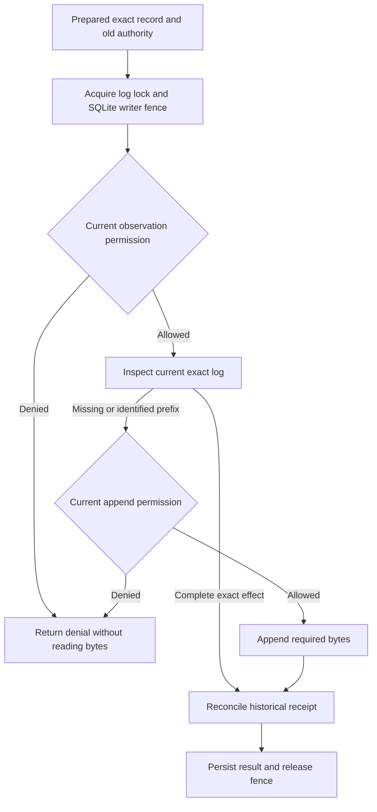

# Separate authority to reconcile an old effect from a new append

This RT-19/04 study compares policies for recovering a prepared operation after authority changes. A complete external record can already exist. A missing record or known partial frame needs another write. The experiment checks which rights each branch requires, and whether revocation can intervene after the chosen check. [Mutable log recovery](RT-19-MUTABLE-LOG-RECOVERY-2026-11-25.md) · [External-effect revocation](../../language-design/RT-04/RT-04-EXTERNAL-EFFECT-REVOCATION-2026-11-25.md)

## Recovery rules

The native fixture uses the same exact framed log and SQLite WAL intent and receipt as the earlier mutable-log experiment. A local authority row has separate observation and append permissions and an epoch. A process stops before an effect, after a known prefix, after a complete record or after receipt commit. The preparing authority is retained as provenance. The recovery rule can instead read the current rights.

The split rule checks observation permission before reading external log bytes. When the exact record already exists, it can verify or record a historical receipt with only observation permission. Writing a new frame or completing a prefix needs current append permission as well. Recording the internal receipt is a trusted service operation in this fixture. A separate process can revoke rights after the candidate check and before the logical recovery result.



The comparison reuses prepared authority, requires both current rights for every result, splits current rights without retaining a fence, or combines the split with `BEGIN IMMEDIATE`. All participating revocations update the same authority database. The fenced recovery holds the transaction across the external effect and receipt. The independent revoker receives `SQLITE_BUSY` at the tested cut and completes after the recovery result commits.

## Results

Twelve schedules cross four policies for 48 tests. An unauthorized effect writes new bytes after append permission changes. An unauthorized disclosure is a proof result admitted after observation permission is revoked at the logical decision point. The historical positive has a complete exact effect with current observation permission and revoked append permission. The table counts 12 schedules per policy.

| Recovery policy | Proof results | Unauthorized effects | Unauthorized disclosures | Valid historical result denied |
|---|---:|---:|---:|---:|
| Prepared authority | 12 | 4 | 4 | 0 |
| Fresh read and write for every result | 6 | 2 | 1 | 1 |
| Separate fresh rights without fence | 7 | 2 | 1 | 0 |
| Separate fresh rights with SQLite writer fence | 7 | 0 | 0 | 0 |

Prepared authority permits four unauthorized effects and four disclosures. Requiring both current permissions skips one valid historical reconciliation and still admits two unauthorized effects and one disclosure when the relevant permission changes again. Splitting the fresh checks preserves the historical result, while retaining both late races. The fenced split preserves seven checked proof results with zero unauthorized effects or disclosures in these schedules. The missing and partial operation controls remain unmodified after append revocation. A completed effect with revoked observation permission is denied before the service reads the log bytes.

## Limits and replay

The checked decision is local and occurs at the fenced result. Network delivery after the fence, acknowledgement loss, separate identity services and bypassing writers require their own protocols. The coarse fence assumes a compatible authority database and namespace lifecycle. It does not make POSIX writes and SQLite commits one atomic storage operation. The earlier exact recovery study covers the tested process-stop gap. Power-loss durability, production rights, policy adoption and independent review remain open.

Use CPython 3.12.14, SQLite 3.53.1 and the recorded Linux kernel. The initial LLMLang baseline is `e53a054cdacc1ccb5f7410b9921d0d7d1971bc4b`. The ledger pins the earlier log runner and captures byte effects, exact authority epochs and independent process outcomes. Replay from the checkout containing both fixture versions.

```bash
fixture=research/toolchain-and-collaboration/RT-19/RECOVERY-AUTHORITY-01
PYTHONHASHSEED=1 python3 -B "$fixture/run.py" > /tmp/llmlang-rt19-recovery-auth.json
cmp "$fixture/evidence.json" /tmp/llmlang-rt19-recovery-auth.json
python3 "$fixture/chart.py"
```

See the [native fixture](RECOVERY-AUTHORITY-01/run.py), [measured ledger](RECOVERY-AUTHORITY-01/evidence.json), and [table generator](RECOVERY-AUTHORITY-01/chart.py).
