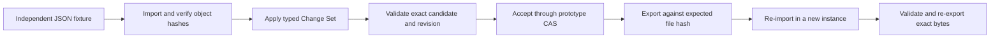

# RT-19. Deterministic Toolchain import and export round trip

This vertical slice runs the public in-memory Toolchain API from an independently serialized import through typed changes, exact validation, acceptance, export and re-import in a fresh instance. The fixture models an integer offset with separate contract and implementation entities. The validator checks exact integer types and compares their outputs on nine values. The acceptance adapter binds its result to the workspace, revision, snapshot root and validation profile. [Issue #337](https://github.com/aivibeflow/LLMLang/issues/337) · [Toolchain Prototype 01](../PROTOTYPES/TOOLCHAIN-SERVER-01/README.md)



## Results

The replay checks three offsets, six import entity orders, 24 operation orders and two input formatting styles. Each batch updates two entities, removes a legacy note and adds one export entity. All 864 runs match the independent root and export bytes. The old snapshot retains the removed entity, the new snapshot has no such entity, and a clean instance exports the same bytes after re-import and revalidation. All nine prototype unit tests also pass. [Deterministic evidence](TOOLCHAIN-ROUNDTRIP-01/evidence.json)

| Control | Result |
| --- | --- |
| Contract and implementation disagree | Validation refuses the candidate. The prototype refuses export while it remains unaccepted. |
| Both offsets are Boolean | Domain validation refuses both values. |
| The same semantically invalid candidate goes directly to the lifecycle accept call | The prototype accepts and exports it. Semantic checks belong to the validation adapter in this slice. |
| Export metadata changes after validation | The earlier validation result is stale. Fresh validation admits the new exact snapshot. |
| Destination changes outside the Toolchain | Export returns a stale-file error and retains the external bytes. |
| Entity content changes while its recorded hash stays fixed | Import refuses the damaged file. |

The receipt and domain verifier are in-process fixture components. The replay establishes a working vertical slice for the generic entity model and its single-file prototype interchange. It leaves authorization, typed LLMLang semantics, signed validation evidence, durable workspace state, Git/SQLite integration and concurrent export failures open.

## Replay

Source baseline `d8f3825` on `research/all`. Replay used CPython 3.12.14 on Linux 6.18.57. Run from the repository root.

```sh
data=research/toolchain-and-collaboration/RT-19/TOOLCHAIN-ROUNDTRIP-01
receipt=$(mktemp)
python -B -m unittest discover -s research/toolchain-and-collaboration/PROTOTYPES/TOOLCHAIN-SERVER-01 -v
python -B "$data/run.py" "$receipt"
cmp "$data/evidence.json" "$receipt"
rm "$receipt"
```
