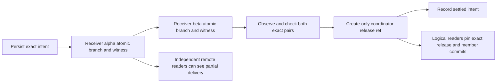

# Recovering publication to two Git repositories

[Toolchain Server tracking issue #337](https://github.com/aivibeflow/LLMLang/issues/337) · [Prepared multi-ref recovery](RT-19-MULTIREF-TRANSACTION-RECOVERY-2026-11-25.md) · [Coherent reads](RT-19-COHERENT-MULTIREF-READS-2026-11-25.md)

A Toolchain request can advance more than one Git repository. Git's atomic push groups ref updates within one receiving repository. An earlier receiver may already have committed when a later one refuses. Clients need a receipt that answers what a batch published, and an explicit disposition when delivery stops between recipients.

The fixture uses two bare receivers via local `file://` transport, a separate bare sender that also serves as coordinator, and a SQLite WAL journal with full synchronous mode. The durable intent identifies the batch and the exact previous and desired branch OIDs for each receiver. A participant witness is a Git commit that names that transition and retains the new tip as its parent. One native atomic push per receiver updates its branch using the authorized expected old value and creates the witness ref if absent. Recovery queries both refs and distinguishes the exact pair, untouched old value, matching tip without its witness, divergence, and an unavailable target.



The coordinator can release a logical batch after observing both exact pairs. Its immutable release commit has the ordered participant witness commits as parents, which in turn retain the exact tips. A create-only update publishes its request-specific ref. An observer can recover the existing release after a lost local acknowledgement. The experiment uses independent append and seal rights as explicit fixture inputs. Production remotes need a separate mechanism for authentication and actor fencing.

| Representative schedule | Checked disposition |
| --- | --- |
| Exit after the journal records the intent | Both receivers untouched and no release. An observer sees that append is pending. |
| Exit after alpha | Alpha exact and beta untouched. Recovery needs append rights for beta and seal rights for the logical publication. |
| Exit after beta | Both receivers exact and no release. A seal-only recovery can publish the logical batch without another push. |
| Exit after coordinator release | Both receivers exact and the release visible. An observer settles the exact intent without append or seal rights. |
| Alpha or beta advances independently before recovery | Recovery records a conflict and keeps the observed ref state. |
| Beta advances to the intended tip without its witness | Recovery records a conflict. The matching tip supplies no checked attribution. |
| Beta's update hook refuses the witness | The beta branch and witness both stay unchanged. Alpha remains visible, and retry can settle after the hook is removed. |
| Beta temporarily unavailable | Recovery remains pending observation. The exact retry settles after the target returns. |
| Coordinator ref already points to a different commit | Recovery refuses and preserves the conflicting ref. |
| Alpha changes after release, or between the probes and release | A logical reader still obtains the exact historical member tips. Alpha's current branch is different. |

The 12 schedules run under `files` and `reftable` storage, for 24 native trials. Four schedules per profile exit a separate process at explicit delivery boundaries. Observer refusals, withheld seal, incomplete delivery and receiver refusal produce no logical release. The observation-to-release race demonstrates why the published Git object identifies the historical delivered pair. Sequential probes alone cannot establish the current state of both remote branches at the point that the coordinator publishes.

LLMLang can expose delivery progress separately from a logical publication. Readers of the coordinator receipt get a coherent historical snapshot. Readers of the physical remotes can see partial delivery or independent advancement. A stronger current-remote guarantee needs a common authority or cooperation by each receiver. Compensation after divergence would itself be a new authorized operation with an exact precondition. This experiment keeps partial accepted delivery visible to the recovery procedure and preserves the remote's unrelated change.

The experiment covers local process exits, native push refusal, temporary observation failure and ref divergence. It leaves cross-host authentication, transport loss and ambiguity, production actor fencing, quorum or distributed transaction availability, power-loss durability, and untrusted witness writers open. The fixture's witnesses are controlled Git objects with a shared trusted origin. Their format alone does not authenticate a receiver.

## Reproduce

Linux x86-64, CPython 3.12.14, native Git 2.56.1 with both ref backends, and SQLite 3.53.1. All writes and fault injection occur in temporary local repositories. Receiver branch operations use the actual Git transport, and the fixture checks the resulting refs through `ls-remote`. [Runner](TWO-REMOTE-PUBLICATION-01/run.py) · [Full categorical observations](TWO-REMOTE-PUBLICATION-01/observations.json)

```sh
study=research/toolchain-and-collaboration/RT-19/TWO-REMOTE-PUBLICATION-01
python3 -B "$study/run.py" --out /tmp/rt19-two-remotes.json
cmp "$study/observations.json" /tmp/rt19-two-remotes.json
```
