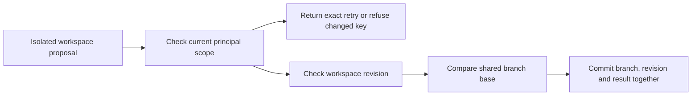

# RT-19 workspace-local concurrency and shared-branch arbitration

Each agent can prepare a change in an isolated workspace. Acceptance must also check the target branch base, because two valid local workspaces can compete for the same shared selection. A retry under the same authorized principal returns the saved exact result.

## Candidate transaction

| Check | Outcome |
| --- | --- |
| Current principal and workspace scope | Refuse before reading or disclosing the stored receipt when the grant is absent. |
| Idempotency | Match principal and request ID, then compare the full exact request fingerprint. Return the original result on a match. Refuse a changed request under the same key. |
| Workspace CAS | Compare exact workspace revision. A locally superseded proposal cannot proceed. |
| Branch CAS | Compare branch with the accepted base. A competing same-base proposal becomes stale after the first acceptance. |
| Durable result | Update branch, workspace revision and receipt in one local transaction. |



The tested route uses one SQLite WAL database and two workspaces in each schedule. The branch rows model shared-head selection. External Git publication and recovery use their own protocol. [Prior workspace CAS observation](RT-19-CONCURRENT-WORKSPACE-CAS-RECHECK-2026-11-24.md) · [Multi-ref recovery](RT-19-MULTIREF-TRANSACTION-RECOVERY-2026-11-25.md)

## Checked outcomes

Across 16 ordered schedules, the second proposal accepts four times when it targets another branch and its workspace is current. It is stale at the branch four times and stale in its own workspace eight times. Same-context retries return the original receipt in all eight cases. The other eight alter the candidate and refuse the reused request ID. Withdrawing the original grant causes all 16 subsequent receipt requests to refuse disclosure. Every scenario verifies both final branch roots and the durable receipt count.

The fixture establishes local acceptance behavior for the specified states. It does not model direct concurrent Git writes, distributed identity or complete semantic merge conflict detection. Production authority and policy for re-planning a stale proposal remain open. [Conservative merge resolution](../RT-24/RT-24-SAFE-MERGE-RESOLUTION-BOUNDARY-2026-11-25.md)

## Reproduce

Use CPython 3.12.14 and SQLite 3.53.1. Hash seeds 37 and 71 produce evidence SHA-256 `6e9e2717bfbb92d7eb9125a7692b46a24a8fb254c6b348be38231f447b08e82e`. [Evidence ledger](WORKSPACE-ARBITRATION-01/evidence.json)

```sh
LC_ALL=C PYTHONHASHSEED=37 PYTHONDONTWRITEBYTECODE=1 \
  python research/toolchain-and-collaboration/RT-19/WORKSPACE-ARBITRATION-01/check.py > /tmp/rt19-arbitration.json
```
