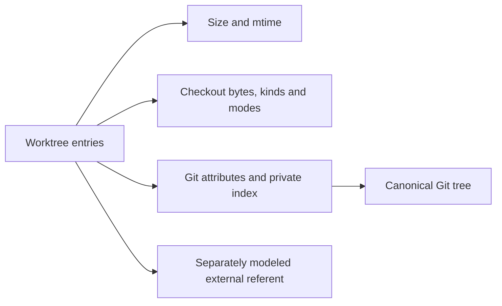

# RT-19. External edits in a checkout and Git tree

A workspace may authorize overwriting a particular checkout or importing a canonical Git tree. Those operations observe different inputs. This experiment compares a file-size and modification-time shortcut, an exact projection of named checkout entries and a canonical tree built by native Git. Each Git observation uses a private empty index. The harness verifies that the existing index stays byte-identical. [Issue #337](https://github.com/aivibeflow/LLMLang/issues/337) · [Multi-file publication comparison](RT-19-MULTIFILE-PUBLICATION-BOUNDARY-RECHECK-2026-11-24.md)

The checkout projection includes entry path, kind, owner-executable bit and either regular-file bytes or literal symlink text. Git stages the same entries with `core.filemode=true` and the fixture's `.gitattributes` rules. The fixture follows one symlink separately to observe a controlled file outside the repository.



## Results

Twelve mutations, three input lengths and two starting line-ending forms give 72 native cases. An explicit truth table expects and checks changes in the three projections, the staged source blob and the separately observed external file.

| Relative to exact checkout edits | Missed edits | False edit reports |
| --- | ---: | ---: |
| Size and mtime | 18 | 6 |
| Canonical Git tree | 6 | 0 |

The size-and-mtime shortcut misses equal-size replacements with restored timestamps, executable bit changes and same-length retargets of a symlink. Touching an unchanged file produces its six false reports. Changing only line endings produces all six raw edits that canonical Git normalizes away. Changing `.gitattributes` from text normalization to literal bytes changes the staged source blob in the three CRLF fixtures even though the checked-out source bytes are untouched. Additions, deletion and a rename to a path with a tab change both content projections. The six changes made only to the external referent preserve both projections. [Raw case ledger](WORKTREE-EDIT-01/evidence.json)

An operation that can overwrite source bytes needs a checkout-bound observation. An import of canonical repository history can use the Git tree and its mode and attribute rules. Tools that follow a link or consume another external input need an explicit dependency boundary for those bytes. The research assumes one completed mutation between observations. It leaves concurrent snapshots, mixed-generation reads, filesystem durability, Git filter execution and portable mode handling open.

## Replay

Source baseline `f12eda0` on `research/all`. Replay used Git 2.56.1, CPython 3.12.14 and Linux 6.18.57 on a local overlay filesystem. All mutations occur in disposable repositories on branch `research/all`.

```sh
data=research/toolchain-and-collaboration/RT-19/WORKTREE-EDIT-01
receipt=$(mktemp)
python -B "$data/run.py" "$receipt"
cmp "$data/evidence.json" "$receipt"
rm "$receipt"
```
