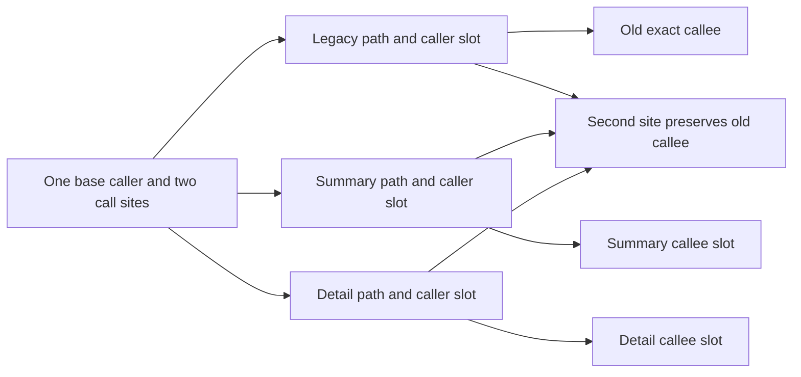

# RT-20. Consumer-specific call and output identities

The current Change Impact Plan represents a shared caller with multiple materialized outputs. The decision binds the base caller, call site, target and consumer path. A path-specific decision also identifies a resulting output slot, and a migrated target may identify a separate selected callee slot. Existing candidate validation checks how those slots bind to the supplied snapshot. [Issue #338](https://github.com/aivibeflow/LLMLang/issues/338) · [Candidate call-site validation](RT-20-CANDIDATE-CALL-SITE-VALIDATION.md)

The fixture gives one base caller two call sites and three consumer paths. The legacy path retains both exact targets. The summary and detail paths select different first targets and preserve the second target. The base caller, site and target tuple identifies only two rows. Adding the consumer path identifies all six. The exact materialization check reads each resulting caller's declaration and compares both its exact callee and the required contract.



## Results

All 288 order replays produce the same plan ID and validate six materialized decisions. Eight controls refuse a wrong consumer path, swapped caller slot, wrong leaf slot, explicit hash conflicting with a slot, missing path-specific slot, wrong output source, duplicate decision or stale snapshot. A plan that omits one decision has a different identity, and the supplied-row validator still validates the five present rows. Exhaustiveness requires the separate plan and graph coverage checks. [Replay ledger](FORK-IDENTITY-01/evidence.json)

A valid mixed plan that supplies explicit hashes on one fork and leaves them to output slots on another exposed a sorting failure in the pinned source. The default record comparison could reach `None` and a hash string while ordering decisions with a common prefix. The fix assigns absent values an explicit sorting position and keeps the previous field order for comparable values. The archived all-slot fixture keeps its exact plan ID, and the mixed fixture now hashes deterministically in both input orders. All 72 focused planning, validation, semantic diff and tree-bound plan tests pass.

The evidence establishes identity and materialization within the existing prototype. The path labels and their intended users are fixture inputs. Authentication of compatibility evidence, consumer-path extraction, deciding whether a split is warranted and production publication remain open.

## Replay

Source baseline `6e58d5a` on `research/all`. Replay used CPython 3.12.14. Run from the repository root.

```sh
data=research/toolchain-and-collaboration/RT-20/FORK-IDENTITY-01
receipt=$(mktemp)
python -B "$data/run.py" "$receipt"
cmp "$data/evidence.json" "$receipt"
rm "$receipt"
```
