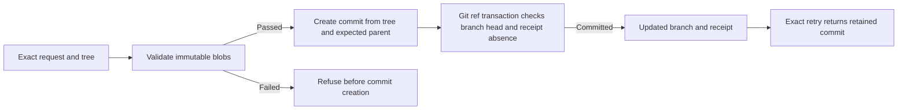

# RT-20. Exact-tree acceptance and retry in Git

A verified change must publish the exact Git tree whose checks passed. It also needs to distinguish a stale baseline from a retry after the original response was lost. This fixture uses one candidate tree hash, one expected parent, one validation profile and one operation key. It runs native Git with SHA-1 and SHA-256 objects and with both the files and reftable ref stores. [Issue #338](https://github.com/aivibeflow/LLMLang/issues/338) · [Candidate semantic diff](RT-20-CANDIDATE-SEMANTIC-DIFF.md)

The fixture validates a small contract and implementation stored in Git blobs. Its program compares the required integer offset with the proposed offset and checks the tree path inventory. The commit is built directly from the validated tree. A Git ref transaction compares the branch head with the expected parent, updates the branch, and creates a receipt ref pointing to the same commit. The receipt's name identifies the operation. The commit data binds the operation, validation profile, parent and tree.



## Results

All 16 isolated cases pass across the four Git configurations. The ordinary cases compare six observations each. The receipt control checks that matching request text alone cannot establish the accepted tree. The concurrent cases start two native writer subprocesses only after both request validations finish.

| Control | Observed result |
| --- | --- |
| Invalid contract or implementation pair | Refusal with no commit object, no branch update and no receipt |
| Working copy changed after validation | Published commit contains the frozen candidate bytes |
| Repeat of accepted request after branch advances | Return original commit and preserve current head |
| Same operation key with the same behavior and different tree bytes | Reject key reuse |
| Matching receipt text with a different committed tree | Reject receipt mismatch |
| Same request submitted at the same baseline by two writers | One publication and one replay, with one added ref-reachable commit |
| Distinct valid requests race for the same expected baseline | One publication and one stale refusal, with no receipt for the losing request |

The same request gets the same receipt result even after another successful change advances the branch. A transaction failure can leave a Git commit object unreachable, since the commit object is written before ref updates. The validation-failure control checks the stronger condition that it creates no commit object at all. The fixture only relies on authoritative branch and receipt refs for publication. [Deterministic results](EXACT-TREE-ACCEPTANCE-01/evidence.json)

Individual ref readers can observe a subset of a multi-ref update, as Git documents. The evidence covers outcomes after the writer commands finish. It leaves open ref visibility during publication, receipt retention, validation evidence authentication, full CIP checks, hard-crash persistence, server integration and coordination with SQLite or other stores. [Git ref transaction documentation](https://git-scm.com/docs/git-update-ref)

## Replay

Source baseline `0b2207d` on `research/all`. The fixture used Git 2.56.1 and CPython 3.12.14 on Linux x86-64. All fixture writes occur in disposable repositories with branch `research/all`. Run from the repository root.

```sh
data=research/toolchain-and-collaboration/RT-20/EXACT-TREE-ACCEPTANCE-01
receipt=$(mktemp)
python -B "$data/run.py" "$receipt"
cmp "$data/evidence.json" "$receipt"
rm "$receipt"
```
