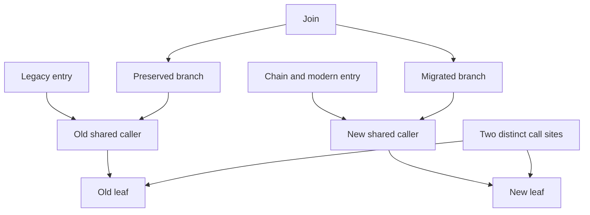

# RT-20. Native caller migration across chains, splits and joins

This prototype exercises exact hash propagation where different clients of one shared caller require different leaf versions. It uses the existing declaration publisher and candidate graph audit, then generates C from the audited exact function objects. Each call enters a recorded object hash. An independent Python evaluator checks the returned integer and ordered call trace. [Issue #338](https://github.com/aivibeflow/LLMLang/issues/338) · [Candidate graph audit](RT-20-CANDIDATE-GRAPH-AUDIT.md)

In the migration, a leaf offset changes from 1 to 3. The modern chain and modern client select the new shared caller. The legacy client keeps the old shared caller. One multi-call entry keeps its first exact leaf and migrates its second. A join follows an unchanged left branch and a migrated right branch. One independent peer stays fixed. A narrow common contract bounds the input and result types, while a separate fixture plan specifies the exact target version at each call site.



## Results

Six profiles run on six entry points with 33 inputs at each of two optimization levels, giving 2,376 native invocations. The baseline and all-old control share the same object graph. All profiles pass the structural audit and agree with the Python evaluator for the exact graph actually executed. The following counts compare each candidate's 198 observations per build with the migration plan. Both builds give identical results.

| Candidate | Wrong scalar results | Wrong exact traces |
| --- | ---: | ---: |
| Exact migration | 0 | 0 |
| Keep all old | 132 | 132 |
| Migrate every consumer of the shared caller | 66 | 66 |
| Swap the two leaf bindings in the multi-call entry | 33 | 33 |
| Select another leaf with identical scalar behavior | 0 | 132 |

In the exact migration, the legacy entry, left branch, old shared caller, old leaf and independent peer keep their hashes. The chain, modern entry, multi-call entry, right branch and join get new hashes. The last control changes one content field ignored by the native arithmetic. Its scalar outputs agree with the plan everywhere, while its selected leaf and dependent call hashes differ. Exact materialization and bounded behavioral validation therefore give separate evidence. [Trace and root ledger](NATIVE-PROPAGATION-01/evidence.json)

This covers all requested graph shapes within a finite acyclic fixture. The generated trace identifies entry into the selected semantic object; it does not characterize a production native call stack. The fixture directly authors migration decisions and does not derive the impact plan. Dynamic references, recursion, contract refinement, full CIP binding and publication remain open. The existing candidate validation, semantic diff and impact planning suites pass 59 focused tests.

## Replay

Source baseline `b4e6046` on `research/all`. Replay used GCC 14.2.0 and CPython 3.12.14 on Linux x86-64. Run from the repository root.

```sh
data=research/toolchain-and-collaboration/RT-20/NATIVE-PROPAGATION-01
receipt=$(mktemp)
python -B "$data/run.py" "$receipt"
cmp "$data/evidence.json" "$receipt"
rm "$receipt"
```
