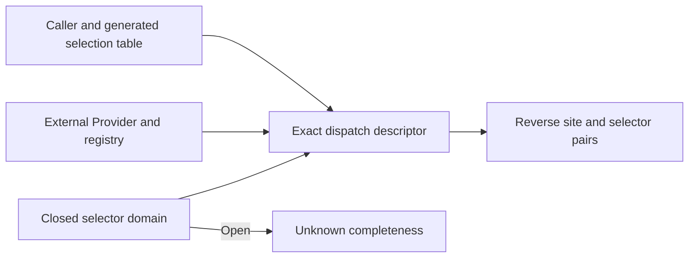

# RT-20. Reverse calls across native dispatch and generated call sites

A migration plan needs to distinguish a complete empty reverse lookup from an unresolved external caller. This experiment compares direct source references, a reusable but unbound call descriptor, and a descriptor pinned to an exact native caller, Provider and selector registry. All fixtures use four selector values and five source call sites. The target identity distinguishes a local function from versions of an external function with the same exported symbol. [Issue #338](https://github.com/aivibeflow/LLMLang/issues/338) · [Candidate graph audit](RT-20-CANDIDATE-GRAPH-AUDIT.md)

The C fixture executes direct calls, a function-pointer table, a generated selection site and required symbol lookups against a shared object. Each function emits a distinct return range. The Python oracle builds the expected dispatch descriptors separately. It uses the observed C returns to verify which exact target received each call. Each reverse result is a set of source site and selector pairs.



## Results

At each of `-O0` and `-O2`, five profiles supply 100 checked native dispatch observations and 50 receipt comparisons. The profiles include a changed registry, a replacement Provider with the same symbol name, a changed generated table and an open selector domain.

| Lookup policy | Outcome over 100 receipt comparisons |
| --- | --- |
| Direct calls only | Wrong reverse set in 90 |
| Unbound descriptor | Wrong reverse set in 44 |
| Exact binding | 16 exact results, 64 stale receipts refused, 20 unknown completeness outcomes |

The baseline external rule appears at selectors 0 and 3. Changing only the registry moves it to selector 2. Replacing the shared object while preserving the original registry and exported names removes the old rule from all selectors. Changing only the generated table moves the local target between selectors 2 and 1. Dropping any one of the three artifact bindings accepts four incorrect sets across both profiles. The matched descriptor accounts for each of these changes. [Case ledger](REVERSE-CALLS-01/evidence.json)

The scope is deliberately finite. With an open domain, runtime traces still run for the same four selectors and the gate reports unknown completeness. The fixture trusts the declaration of the closed domain and builds caller and Provider binaries locally. General points-to analysis, proof that selected descriptors cover supplied binaries, runtime plugin discovery, cross-process calls and integration with CIP remain open.

## Replay

Source baseline `8509bb3` on `research/all`. Replay used GCC 14.2.0, glibc 2.41 and CPython 3.12.14 on Linux x86-64. Run from the repository root.

```sh
data=research/toolchain-and-collaboration/RT-20/REVERSE-CALLS-01
receipt=$(mktemp)
python -B "$data/run.py" "$receipt"
cmp "$data/evidence.json" "$receipt"
rm "$receipt"
```
