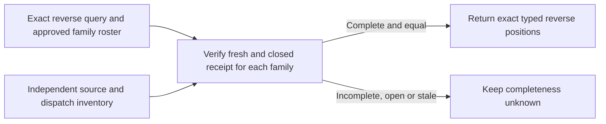

# RT-20 reverse-reference completeness by call kind

An exact reverse lookup requires proven coverage of every call-site family in its scope. A zero-row lookup is complete only when each required family is explicitly closed and checked against the expected inventory. Missing coverage stays unknown.

## Candidate coverage records

| Call family | Required evidence |
| --- | --- |
| Direct | Closed admitted declarations with exact caller, call alternative, target and required Contract reference |
| Indirect | Exact table or points-to facts for the selected body and declared input domain |
| Dynamic | Exact selector and Provider registry with a closed target domain and applicable dispatch evidence |
| External | Exact imported ABI or callback declarations, Provider bytes and boundary scope. Unknown downstream callers keep the external scope open. |
| Generated | Exact generator input, version, admitted output and occurrence mapping for the selected build artifacts |

All records bind snapshot, queried target, extractor and declared scope. The gate checks the exact family roster, closed status, and positions against an independent supplied inventory. Results retain typed family and position. A production implementation must establish the declared inventory independently and authenticate the evidence. [Native reverse calls](RT-20-NATIVE-REVERSE-CALLS-2026-11-25.md) · [Independent source and reverse coverage](../RT-24/RT-24-MERGE-ADMISSION-COVERAGE-2026-11-25.md)



## Checked outcomes

Across 3,125 combinations, each of five families supplies an exact, missing, open, stale or disagreeing record. The only exact combination contains all five current and complete records. The other cases return 2,101 unknown family rosters, 781 stale results, 211 open domains and 31 inventory disagreements. The empty controls distinguish a complete no-caller result from missing, duplicate or open families.

The finite gate complements the native selector study. It verifies the consumer's handling of coverage receipts and makes no claim of general dynamic analysis. Frontend and generated-source correspondence, completeness across actual external registries, recursion and runtime changes remain open.

## Reproduce

Use CPython 3.12.14. Python hash seeds 37 and 71 produce evidence SHA-256 `81b1da073eba5eb81173c46746b71ae2ea4f461a858839ab312b5537a71fcca3`. [Evidence ledger](REVERSE-COVERAGE-01/evidence.json)

```sh
LC_ALL=C PYTHONHASHSEED=37 PYTHONDONTWRITEBYTECODE=1 \
  python research/toolchain-and-collaboration/RT-20/REVERSE-COVERAGE-01/check.py > /tmp/rt20-reverse-coverage.json
```
