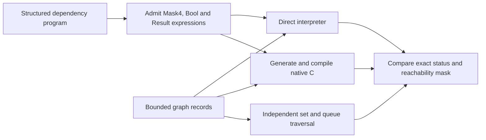

# A structured dependency tool as an executable bootstrap pilot

[Core semantics issue #291](https://github.com/aivibeflow/LLMLang/issues/291) · [Self-development roadmap](RT-21-LLMLANG-SELF-DEVELOPMENT-AND-BOOTSTRAP-ROADMAP.md) · [RT-03 downstream edge review](../../language-design/RT-03/RT-03-DOWNSTREAM-EDGE-EVIDENCE-2026-11-25.md)

DEP-094 connects executable language semantics to tools authored in LLMLang. The earlier CLI pilot executed three specialized recipes. This study supplies a small project-specific program in a candidate typed structured source format. The same source goes through a generic admitting interpreter and a C lowering. It computes the reachable dependencies of a selected root in a four-node directed graph.

The source contains the dependency policy, including root validity, both endpoint checks and guarded expansion. The host adapter handles only six-byte records and two-byte results. It performs no dependency analysis. The graph record supplies a presence mask, a root mask, and four neighbor masks. Each number has the candidate `Mask4` type with values from 0 to 15. A valid root is exactly one present node. Every live edge needs two present endpoints. Success returns the reachability mask including the root. Tagged errors distinguish an invalid root from a malformed edge inventory. The input and output carriers, exit codes, and supported effects are explicit parts of the pilot.



The [authored program](DEPENDENCY-BOOTSTRAP-01/dependency-tool.json) uses typed parameters and pure calls, conditional expressions, equality, bit-mask operations, Boolean conjunction and tagged results. Four repetitions of its expansion helper are enough for the finite graph. The admitting frontend checks each inferred type and requires calls to target earlier declarations. In this profile every admitted call chain is finite. Unsupported effects and recursive definitions refuse. The versioned `Mask4` profile is an exploratory part of this pilot.

| Input family | Cases per preserving route |
| --- | ---: |
| Every three-node directed edge inventory, all presence masks and four root choices | 16,384 |
| Four-node chains, cycles and missing terminal endpoints across all node orders | 72 |
| Every root in three four-node projections of the pinned dependency register | 12 |
| Total | 16,468 |

The independent reference implements membership checks and queue-based graph traversal. The direct interpreter and both GCC profiles agree on 1,698 successes, 10,240 invalid roots and 4,530 invalid edge inventories. The exact returned bytes match in every case. The register cases are induced subgraphs from `research/all` at `b1b1579bd21e164c45c4c93e24dafca9945239ee`. They contain actual dependency directions and identifiers. The host encodes the projection before execution. Its results concern reachability inside that projection.

| Source mutation | Different decisions |
| --- | ---: |
| Perform only one reachability expansion | 435 |
| Permit outgoing edges from absent vertices | 306 |
| Permit incoming edges to absent vertices | 330 |

For each of the three variants, the direct interpreter and generated C still agree with each other. The independent graph reference exposes their defects. Six invalid source controls and two malformed wire inputs refuse. A formatting-only serialization changes the raw source hash while preserving the candidate's canonical semantic identity. The changes that affect behavior change both the semantic identity and the native artifact.

The result corroborates the dependency for a structured authoring path. A real tool can put its rules in a typed source with pure calls, branching, checked values and explicit errors while leaving wire effects at a small host boundary. The closed form helps isolate the rules and reproduce the outputs. A general dependency analyzer needs the selected SPG schema and scalable graph, effect and error semantics. The project-wide RT-21 milestone additionally needs the chosen language profile, verified source correspondence and the semantic editing and validation loop. These gates remain open under the roadmap.

## Reproduce

Use Git 2.56.1, CPython 3.12.14 and GCC 14.2.0 on Linux x86-64. The [runner](DEPENDENCY-BOOTSTRAP-01/run.py) records exact source and interpreter fingerprints, native source and binary hashes, the graph corpus digest, register provenance and the categorical outcomes. Its input generation and independent traversal are implemented separately from [admission and lowering](DEPENDENCY-BOOTSTRAP-01/fragment.py). The [observations](DEPENDENCY-BOOTSTRAP-01/observations.json) preserve the checks and first witnesses. No latency or throughput comparison was made.

```sh
study=research/toolchain-and-collaboration/RT-21/DEPENDENCY-BOOTSTRAP-01
PYTHONHASHSEED=1 python3 -B "$study/run.py" --out /tmp/rt21-dependency-bootstrap.json
cmp "$study/observations.json" /tmp/rt21-dependency-bootstrap.json
```
