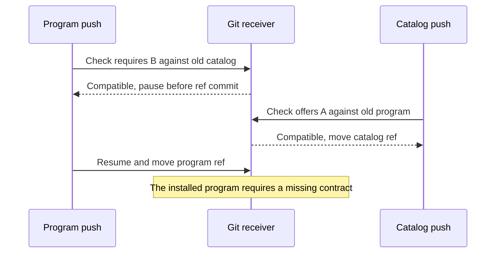

# RT-23 — Cross-ref validation during concurrent Git receives

Two concurrent receives each passed semantic validation against a different unchanged peer ref. Both refs moved, leaving an incompatible pair. Locking only the validator had the same result, including when each push requested atomic updates. A lock spanning the entire receiver allowed a retried push to see the committed peer ref and reject the incompatible proposal.

## Method

The local bare repository uses the Git 2.52.0 files ref backend. One branch contains a program requirement and a second branch contains the provider catalog. The baseline program requires `A`. The baseline catalog offers `A` and `B`. One sender changes the requirement to `B` while the other drops `B` from the catalog. Both proposals are compatible with the baseline version of the other branch. Their combined state is incompatible. These are small JSON contracts modeling a cross-ref dependency.

A transaction-wide `pre-receive` hook validates the incoming commit paired with either the proposed peer commit in the same push or the receiver's current peer commit. The runner pauses the first native receiver at an acknowledged checkpoint and completes the second push before releasing it. An ordinary run pauses after validation and before `pre-receive` returns. The other racing cases pause in the native `reference-transaction` prepared hook after validation is complete. The runner verifies the two exact branch refs still hold the baseline at each checkpoint.

The hook-only lock serializes the checks. The whole-receive lock is acquired before Git starts its receiver and remains held until that receiver exits. A participating sender gets a busy result while the first receiver is active. The retry performs a fresh receive. A separate control sends the second push through the regular receiver entry point to test the dependency on all writers participating.



## Results

| Lock scope | Both via wrapper | Atomic requested | Batch | Git exit by actor | Final compatibility |
| --- | --- | --- | --- | --- | --- |
| none | no | no | separate | catalog 0, program 0 | incompatible |
| hook-only | no | yes | separate | catalog 0, program 0 | incompatible |
| whole-receive | yes | no | separate | catalog 128, catalog-retry 1, program 0 | compatible |
| whole-receive | no | no | separate | catalog 0, program 0 | incompatible |
| whole-receive | yes | yes | joint | joined 0 | compatible |

The three incompatible runs log two accepted checks. Each decision names the new ref it was offered and the old peer ref it actually observed. Their native prepared and committed hook order shows the catalog write finishing before the paused program write. Atomic push controls the refs in one receive. In the separate atomic pushes the two validations still complete independently.

In the fully coordinated run the second sender first sees receiver busy. Its retry reads the new program and fails the semantic check. The original catalog remains selected, keeping the valid offer of `B`. The joint positive control replaces both commits in one atomic push. Its validator sees both new commits and verifies their compatibility. The ledger tracks exact commits, native phases and exit status separately from the final contract check.

## Implementation boundary

A whole-receive lock covers the checked ref update for cooperating writers. A common commit/ref transaction could also cover the dependent baseline values and reject stale proposals. The experiment verifies only the scoped Linux/files-backend lock and joint native transaction. It relies on all writers using the selected publication entry point for the lock guarantee. Other ref backends, independent ref writers, protected hosting configuration, RT-20 evidence binding, and synchronized worktree publication remain open. The run records controlled ordering and contains no throughput measurement.

## Reproduce

Use Git 2.52.0 and CPython 3.12.14 on Linux. The runner changes configuration only in temporary repositories and pins author and timestamp fields.

```sh
fixture=research/toolchain-and-collaboration/RT-23/CONCURRENT-RECEIVE-01
output=$(mktemp)
python3 "$fixture/run.py" --output "$output"
cmp "$fixture/evidence.json" "$output"
python3 "$fixture/chart.py"
```

[Runner](CONCURRENT-RECEIVE-01/run.py) · [Gate and receiver](CONCURRENT-RECEIVE-01/gate.py) · [Evidence ledger](CONCURRENT-RECEIVE-01/evidence.json) · [Interface mapping merge](RT-23-INTERFACE-MAPPING-MERGE.md) · [Git hooks](https://git-scm.com/docs/githooks)
