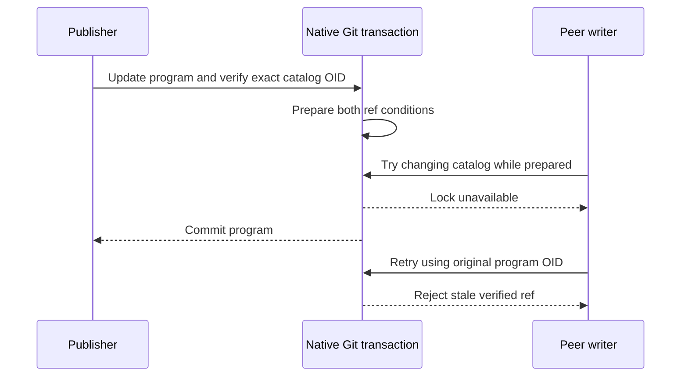

# RT-23 — Checking dependent refs in the native publication transaction

A native Git ref transaction can verify the expected value of a dependent ref without updating it. In the files backend the verification held that peer ref while the transaction prepared, blocking a concurrent writer. In the reftable backend the tested prepared transaction already blocked a peer writer. Both backends still needed the verify operation to reject a peer replacement that completed before preparation.

## Method

Two Git refs point to immutable program and catalog fixtures. The original program requires contract `A`, and the original catalog offers `A` and `B`. One writer switches the program to `B`. The other removes `B` from the catalog. Each has checked its proposed change against the original other ref. Their combined result violates the contract.

The loose preflight policy verifies the program ref's old OID in `update-ref --stdin` and relies on an earlier read for the catalog. The transactional policy adds `verify <catalog-ref> <expected-oid>` to the same transaction as the program update. The runner either commits the peer change before preparation or pauses the primary writer at the native `reference-transaction` prepared hook. It records exact OIDs, Git responses and final compatibility. On lock contention the peer retries with its original expected program OID in its own transaction. The tests disable Git's lock wait in order to observe contention without a timing guess.



## Results

| Ref backend | Peer write | Verify peer | Primary outcome | Peer outcome | Compatible final pair |
| --- | --- | --- | --- | --- | --- |
| files | before-prepare | no | committed | committed | no |
| files | before-prepare | yes | stale-verified-ref | committed | yes |
| files | while-prepared | no | committed | committed | no |
| files | while-prepared | yes | committed | ref-lock-unavailable | yes |
| reftable | before-prepare | no | committed | committed | no |
| reftable | before-prepare | yes | stale-verified-ref | committed | yes |
| reftable | while-prepared | no | committed | ref-lock-unavailable | yes |
| reftable | while-prepared | yes | committed | ref-lock-unavailable | yes |

All three blocked peer attempts fail the verified retry after the program changes. The files backend exposes the catalog lock file only when the transaction includes the verify operation. Both prepared hooks record the verified catalog entry with its expected old OID and Git's zero new OID. In those verified trials the catalog remains unchanged when the primary transaction commits. The ledger retains the exact hook inputs and actual refs.

The reftable contention result demonstrates a serialization boundary while one transaction prepares. With the catalog change already committed, reftable still accepts the incompatible pair when the program transaction omits its dependency condition. Transaction lock scope and expected-state validation answer separate questions.

## Implementation boundary

Including checked dependent refs in a transaction is a candidate for a Toolchain-controlled publication path. It can provide tighter ref participation than locking an entire receive. All publishers still need to supply valid expected refs and semantic policy. Native Git only compares the supplied OIDs. Actor authorization, ref updates that bypass this protocol, unrelated filesystem state, revision generations for away-and-back edits, and production receipt integration remain open. The test covers two backends, two refs and two deterministic schedules without measuring throughput.

## Reproduce

Use Git 2.52.0 and CPython 3.12.14 on Linux. The runner uses isolated local bare repositories and content-addressed fixture blobs.

```sh
fixture=research/toolchain-and-collaboration/RT-23/DEPENDENT-REF-VERIFY-01
output=$(mktemp)
python3 "$fixture/run.py" --output "$output"
cmp "$fixture/evidence.json" "$output"
python3 "$fixture/chart.py"
```

[Runner](DEPENDENT-REF-VERIFY-01/run.py) · [Prepared hook](DEPENDENT-REF-VERIFY-01/checkpoint.py) · [Evidence ledger](DEPENDENT-REF-VERIFY-01/evidence.json) · [Concurrent receive comparison](RT-23-CONCURRENT-RECEIVE-VALIDATION-2026-11-24.md) · [Git update-ref](https://git-scm.com/docs/git-update-ref)
