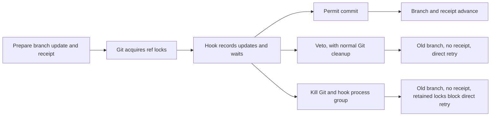

# RT-23 — Recover after Git stops inside ref preparation

**Evidence** — Six native Git cases on the files and reftable backends.

## Question and method

An exact-tree publisher creates a durable branch pointer and an operation receipt in one Git ref transaction. Previous RT-23 and RT-19 experiments interrupted the operation around that Git command. This comparison stops the Git process itself after it has prepared both updates and acquired its locks. Does an unchanged branch with no receipt still imply an immediate retry can publish? Does backend choice change which writes a stopped operation blocks? [Exact-tree recovery](RT-23-EXACT-TREE-COMMIT-RECOVERY.md) · [SQLite/Git command-boundary recovery](../RT-19/RT-19-SQLITE-GIT-PROCESS-RECOVERY-2026-11-24.md)

In a disposable repository, the publisher prepares one commit whose tree and typed semantic root have already been validated. The proposed ref changes compare the branch to its expected OID and create a receipt naming the same candidate. A native `reference-transaction` hook at `prepared` records the exact old and new OIDs for both updates, then waits for a control message on a FIFO. The controller observes branch, receipt and locks at this boundary. It then permits commit, returns a hook veto, or sends `SIGKILL` to the isolated Git process group. The group contains only the fixture publisher and its hook.



The hook provides a controlled cut before commit. The observer still reads the previous branch OID and no receipt in all six prepared states. Ordinary cleanup and abrupt termination differ even though the logical recovery state initially appears the same.

## Observations

| Backend and cut | Branch and receipt immediately after cut | Retained locks | Ordinary retry | Write an unrelated ref after an abrupt cut |
| --- | --- | ---: | --- | --- |
| Files, permit commit | Candidate and candidate | 0 | Resolves existing publication | — |
| Files, hook veto | Old branch, absent receipt | 0 | Publishes exact candidate | — |
| Files, kill after prepare | Old branch, absent receipt | 2 | Blocked by lock | Succeeds |
| Reftable, permit commit | Candidate and candidate | 0 | Resolves existing publication | — |
| Reftable, hook veto | Old branch, absent receipt | 0 | Publishes exact candidate | — |
| Reftable, kill after prepare | Old branch, absent receipt | 1 | Blocked by lock | Blocked by lock |

The files backend retained the individual branch and receipt locks. The reftable backend retained the table-list lock and blocked a write to an unrelated branch in the same repository. The existing recovery inspector returned `retryable` for both killed cases because it checked the branch and receipt, and the immediate retry then failed. In the fixture the controller knew the only relevant writer group was dead, verified the old branch and absent receipt again, then removed the exact retained fixture locks. Retrying published the same prepared commit and receipt on both backends. Every final receipt identifies the approved content and reconstructed root.

A recovery API can distinguish eligibility by exact ref identities from present write availability. The backend choice trades per-ref lock scope in the tested files backend against a shared table-list lock in reftable. Production repair requires a reliable way to establish writer ownership and exclusion. This experiment has that information because all writers and repositories are disposable and controlled. It does not test partial visibility during the commit phase, power-loss durability, remote repositories or permission to remove unknown locks. [Git update-ref](https://git-scm.com/docs/git-update-ref) · [Git hooks](https://git-scm.com/docs/githooks#_reference_transaction)

## Reproduction

Use Git 2.52.0 and CPython 3.12.14 on Linux from the repository root:

```sh
study=research/toolchain-and-collaboration/RT-23/GIT-PREPARED-CRASH-01
python3 -B "$study/run.py" --output /tmp/rt23-prepared-crash.json
cmp "$study/evidence.json" /tmp/rt23-prepared-crash.json
(cd research/PROTOTYPES/DEPENDENCY-GRAPH-01 && python3 -B -m unittest \
  tests.test_rt23_ref_generation tests.test_rt23_commit_recovery tests.test_rt24_tree_bound_cip)
```

The [harness](GIT-PREPARED-CRASH-01/run.py) uses fixed commit dates, a bounded rendezvous and fresh temporary repositories. The [ledger](GIT-PREPARED-CRASH-01/evidence.json) includes the exact prepare records, ref and lock observations, process results, and final publication for each case.
