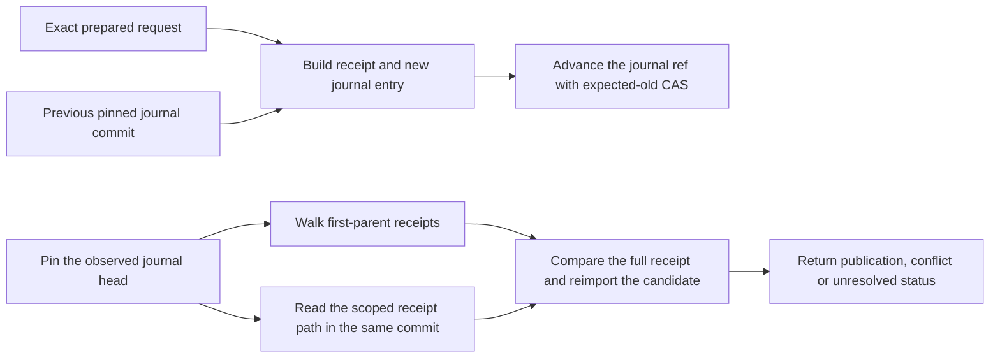

# Recover old publication receipts through a Git journal tree

A synchronized LLMLang commit can succeed at its authoritative journal ref just before the client loses the response. By the time the client retries, many more operations may have completed. Recovery must distinguish an accepted operation, conflicting reuse of its key, and an operation with no decision in the selected journal view. An earlier experiment put the exact decision in a single Git ref and demonstrated process interruption. This experiment compares receipt lookup in a longer journal and after clean-clone reconstruction. [Single-ref journal recovery](RT-23-SINGLE-JOURNAL-REF-2026-11-24.md) · [Plan §4.5](../../../PLAN.md#45-end-to-end-semantic-merge-and-synchronized-commit-lifecycle)

## Candidate layouts and recovery protocol

- **Full scan** inspects the publication blob in each journal commit's first-parent chain. The second parent names the exact accepted candidate and keeps it reachable. A complete scan can establish the absence of a request at the pinned journal head.
- **Eight-entry scan** reads the same history with a limit of eight inspected receipts. If it cannot establish an outcome within that limit, it reports `history-window-exhausted`. This outcome requires more evidence before a retry can publish.
- **Indexed tree** stores the current publication blob and a cumulative mapping in the same Git commit tree. The mapping uses the SHA-256 of canonical JSON for the pair `[project scope, operation key]`. The first two hexadecimal characters name a directory. The remainder names a receipt file. At read time, the receipt's exact scope, key, candidate, tree, semantic root and ordered parents must match the prepared request. Old generations remain readable at their original commit OIDs.



Compare-and-swap (CAS) updates a ref only if its old value equals the caller's expected OID. The indexed writer starts with the previous mapping and adds one scoped key, reusing unchanged bucket trees. The entry and its mapping become visible through the same ref update. Querying a pinned head gives an answer for that generation. A client seeking the current decision must obtain the current authorized head and apply the expected-old check if it subsequently writes. A present receipt still requires independent validation of its candidate's exact tree, ordered ancestry and reconstructed typed root.

The harness builds the alternative journal histories over the same source candidates in disposable repositories. For each of Git's files and reftable ref backends, it publishes 64 revisions of a closed manifest and contract declaration, then probes a 65th before and after updating the journal. The ordinary Git branch stays at the base in every probe. The two authoritative refs coexist only to compare the candidates in the fixture. Each proposed design needs just one journal ref per protected namespace. A clean clone first omits both private journal refs and then explicitly fetches them. Nine local queries are replayed in that clone. The observer also compares all receipt paths and blob OIDs at the 32-entry and 65-entry heads with the first-parent journal's receipts.

## Outcome and cost comparison

Each cell pairs a decision with the number of receipt records read for that lookup. The nine query rows after the CAS probes have identical local and clean-clone results. All rows agree across the two ref backends. The metric counts logical receipt examinations. Git also reads commit and tree objects, and successful requests reimport source. The count measures neither total object reads nor elapsed time.

| Query | Full scan | Eight-entry scan | Indexed tree |
|---|---|---|---|
| Before journal CAS | `undecided` / 64 | `history-window-exhausted` / 8 | `undecided` / 0 |
| After journal CAS | `published` / 1 | `published` / 1 | `published` / 1 |
| Oldest request | `published` / 65 | `history-window-exhausted` / 8 | `published` / 1 |
| Same request key in another scope | `published` / 64 | `history-window-exhausted` / 8 | `published` / 1 |
| Middle of history | `published` / 34 | `history-window-exhausted` / 8 | `published` / 1 |
| Second newest request | `published` / 2 | `published` / 2 | `published` / 1 |
| Newest request | `published` / 1 | `published` / 1 | `published` / 1 |
| Same key and tree, different commit | `request-conflict` / 65 | `history-window-exhausted` / 8 | `request-conflict` / 1 |
| Absent request | `undecided` / 65 | `history-window-exhausted` / 8 | `undecided` / 0 |
| Later request at the pinned prefix | `undecided` / 32 | `history-window-exhausted` / 8 | `undecided` / 0 |
| Old request at the pinned prefix | `published` / 32 | `history-window-exhausted` / 8 | `published` / 1 |

| Git object type | Full scan objects | Indexed objects | Full scan bytes | Indexed bytes |
|---|---:|---:|---:|---:|
| commit | 132 | 132 | 35,261 | 35,269 |
| tree | 198 | 329 | 10,516 | 80,998 |
| blob | 132 | 132 | 37,473 | 37,473 |

Full and indexed lookups agree on all 11 cases per backend. The oldest receipt takes 65 record examinations in the full scan and one in the index. The bounded scan resolves three cases and leaves eight unresolved. Both complete routes distinguish the same request key in separate project scopes. They reject a request for a different commit even when its source tree and expected parents are equal. An exact candidate and prepared receipt objects are insufficient for publication before the journal CAS. After that CAS, retry observes the exact decision while the ordinary branch still points at the base. The stale CAS fails for both layouts, and the writer refuses to append a second receipt for an existing scoped key.

The object table counts unique objects reachable from each final journal tip in the clean clone. Bytes are uncompressed Git object payloads, including retained history. The index adds 131 trees and 70,482 tree payload bytes in this history. Its flat directory of shard trees is copied on updates and accounts for a growing part of the storage. Receipt blob counts and bytes are unchanged. Compression, transfer cost and read latency require separate measurements on representative histories.

## Scope and replay

The index gives a definitive negative answer under a protected append-only writer invariant. The complete path/blob audits check the invariant at two pinned generations in this experiment. A hash-derived file path alone cannot establish that a writer kept all prior decisions. A stale local cache or compacted history needs a completeness and retention contract before it can authorize a retry. The tested journal decision and ordinary branch projection remain separate. The earlier single-ref experiment covers process interruption and branch divergence. This fixture exercises visibility on both sides of a native CAS without interrupting the process.

This experiment leaves authorization, production collision policy, receipt expiry and compaction, malformed or rewritten journal handling, branch projection and worktree synchronization, repository transfer cost, power-loss durability and independent review open. It uses one branch, two request scopes, SHA-1 Git repositories and Linux x86-64. Candidate input inventories and roots use the closed RT-24 prototype. The approach also depends on the Toolchain contract for exact idempotency and synchronized completion. [RT-19 durable operations](../RT-19/RT-19-TOOLCHAIN-SERVER-AND-SEMANTIC-DEVELOPMENT-API.md) · [RT-22 repository contract](../RT-22/RT-22-LLMLANG-GIT-REPOSITORY-AND-WORKTREE-MCP.md) · [RT-20 verified completion](../RT-20/RT-20-LLM-PATCH-PLANNING-AND-HASH-PROPAGATION.md#8-mandatory-completion-and-verified-git-commit)

The initial repository baseline is `d75fd5474950944a2a101bc419316603abb1fb78`. Use Git 2.52.0 and CPython 3.12.14 from the repository root. The runner records exact query observations, pinned journal and candidate OIDs, scoped keys, source digests, tool versions and retained object counts. Repositories, layout, scopes, request order and commit metadata are deterministic.

```bash
fixture=research/toolchain-and-collaboration/RT-23/INDEXED-JOURNAL-RECOVERY-01
LC_ALL=C PYTHONHASHSEED=1 python3 -B "$fixture/run.py" > /tmp/llmlang-indexed-journal.json
cmp "$fixture/evidence.json" /tmp/llmlang-indexed-journal.json
python3 "$fixture/chart.py"
```

[Native runner](INDEXED-JOURNAL-RECOVERY-01/run.py) · [Machine-readable evidence](INDEXED-JOURNAL-RECOVERY-01/evidence.json) · [Table generator](INDEXED-JOURNAL-RECOVERY-01/chart.py) · [Pinned Git retention](RT-23-PINNED-GIT-RETENTION-2026-11-25.md)
