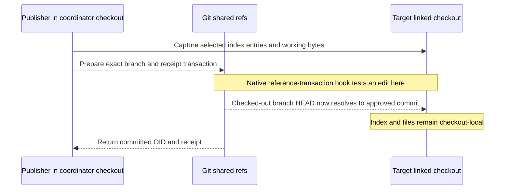

# RT-23 — Separate Git publication from linked-worktree synchronization

**Evidence** — Eight native Git cases with a branch checked out in a linked worktree and a publisher operating from another checkout.

## Question and policies

Can an exact-tree publication receipt also certify the local index and working files of the checkout that displays the new commit? RT-23 requires both a durable Git result and synchronization with the selected worktree. Existing exact-tree recovery can publish a prepared candidate while deliberately preserving the user's real index and later file edits. This experiment separates that guarantee from how a checkout presents the result and tests the gap with two linked worktrees. [Exact-tree recovery](RT-23-EXACT-TREE-COMMIT-RECOVERY.md) · [RT-23 synchronization protocol](RT-23-SINGLE-INSTANCE-TOOLCHAIN-AND-INCREMENTAL-MULTI-WORKTREE.md#92-commit-preparation-and-synchronization-protocol)

Three policies use the same prepared commit, semantic root and atomic ref-plus-receipt update. Ref-only publication compares the branch OID and validates the prepared candidate. Scoped preflight additionally compares the selected working-file bytes and real index entries with the values captured at preparation. Coordinated preflight holds an advisory lock through those comparisons and ref publication. Each check operates on the target checkout's semantic source and one selected ordinary file. The fixture excludes unrelated files and staging from the selected set, following the contract that unrelated user edits should be preserved.



Both checkouts share refs and objects. The coordinator branch stays at the old commit. The target's symbolic HEAD points to the updated branch, even when its index and files stay where they were. The concurrent control runs through Git's real `reference-transaction` hook in the prepared stage. It writes and stages a selected file before Git commits the branch and receipt. The lock case switches that external process to the same advisory lock with nonblocking acquisition, and the bypass case keeps the ordinary writer.

## Results

| Control | Publication result | Target index equals approved tree | Selected working file equals approved content |
| --- | --- | --- | --- |
| Ref-only with a private candidate index | Published | No | Yes |
| Selected content already staged in target index | Published | Yes | Yes |
| Selected working bytes change before preflight | Rejected as stale, no receipt | No | No |
| Selected index entry changes before preflight | Rejected as stale, no receipt | No | Yes |
| Unselected staged, unstaged and untracked edits | Published, all user edits preserved | No | Yes |
| Ordinary edit during ref prepare, no coordinating lock | Published | No | No |
| Cooperating edit during ref prepare, same lock | Published, writer deferred | Yes | Yes |
| Ordinary edit during ref prepare, bypassing the held lock | Published | No | No |

Every published receipt names the exact prepared commit, whose tree reconstructs the approved semantic root and contains the approved selected text. In the ref-only control the target's HEAD resolves to that commit while the user index retains the old content. Git status then reports staged changes back toward the old files and separate unstaged changes toward the approved files. In the two late-edit controls the real index and selected working file both contain the intervening edit. The commit and receipt still show the originally approved candidate. The control with unselected edits synchronizes both selected index entries. Full-index equality would reject that checkout because it also contains an unrelated staged edit.

A release operation should represent publication and selected checkout synchronization with separately inspectable evidence. Scoped preflight can reject edits already visible before the ref transaction. A cooperating writer can be serialized by the same checkout lock. Native Git and uncoordinated file writers can bypass that lock, so a production guarantee needs an enforceable writer model or a later observation that reports checkout divergence and preserves the user's changes. This experiment does not establish atomic filesystem synchronization, conflict-free update of arbitrary staging states, power-loss durability or cross-platform locking. [Coordinated branch generation](RT-23-COORDINATED-REF-GENERATION.md) · [RT-24 commit lifecycle](../../../PLAN.md#45-end-to-end-semantic-merge-and-synchronized-commit-lifecycle)

## Reproduction

Run from the repository root with Git 2.52.0, CPython 3.12.14 and util-linux `flock` 2.41.5. The fixture schedules the competing process through the Git hook, without timing or sleep assumptions.

```sh
study=research/toolchain-and-collaboration/RT-23/LINKED-WORKTREE-01
python3 -B "$study/run.py" --output /tmp/rt23-linked-worktree.json
cmp "$study/evidence.json" /tmp/rt23-linked-worktree.json
(cd research/PROTOTYPES/DEPENDENCY-GRAPH-01 && python3 -B -m unittest \
  tests.test_rt23_ref_generation tests.test_rt23_commit_recovery \
  tests.test_rt23_mapping_tree_publication tests.test_rt24_tree_bound_cip)
```

The [harness](LINKED-WORKTREE-01/run.py) checks the eight declared outcomes and verifies every published candidate. The [ledger](LINKED-WORKTREE-01/evidence.json) preserves branch, HEAD, receipt, actual index, stage status and working-file observations before and after publication. The table reports each categorical result directly.
