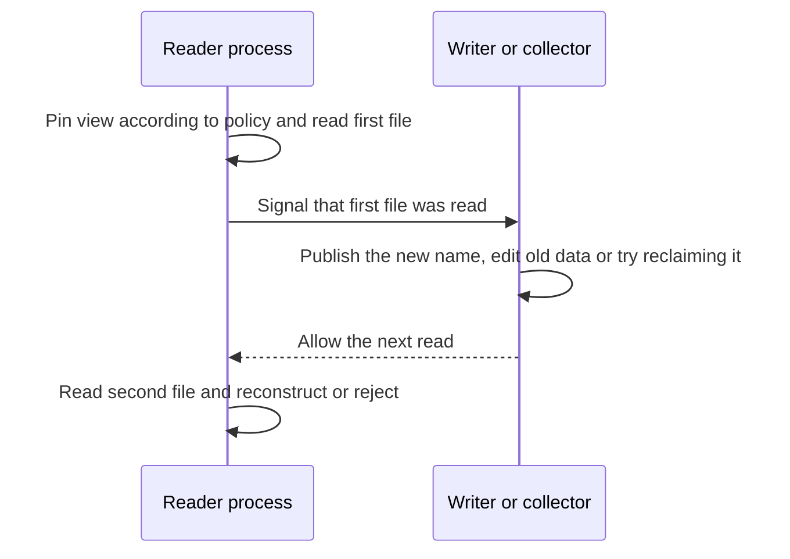

# RT-23 — Keep a multi-file read on one published generation

An atomic pointer or Git ref update still permits a reader to combine files from different generations if it resolves the mutable name separately for each file. Pinning a directory file descriptor preserves the generation across a pointer switch. Retention or immutability can still fail independently. Pinning an exact reachable Git commit preserved the full old snapshot in the tested read.

## Question and method

The [RT-19 publication comparison](../RT-19/RT-19-MULTIFILE-PUBLICATION-BOUNDARY-RECHECK-2026-11-24.md) proposed immutable directory generations and exact Git trees as alternative publication boundaries. The [linked-worktree experiment](RT-23-LINKED-WORKTREE-PUBLICATION-2026-11-24.md) distinguishes Git publication from mutable checkout synchronization. This study isolates what a reader must pin and what a publisher or collector must retain.

Two exact Git commits contain two ordinary declaration files apiece and reconstruct to different closed semantic roots. Their bytes are also materialized in two generation directories. The controller starts a reader process that fetches the first declaration and replies through a pipe. At that cut the controller atomically replaces the generation symlink, updates the Git branch by compare-and-swap, replaces a file inside the old directory, or tries to reclaim that file. Only after the writer action does the reader obtain the second declaration.

The file-descriptor reader opens the directory once and resolves children relative to that descriptor. The retention variant also holds a shared `flock` on the selected generation's lease file while reading. The cooperating collector uses a nonblocking exclusive lock on the same lease file. The manifest reader pins a digest manifest for both declarations and compares it with the fetched bytes. The Git variants use a branch name on each read or resolve that branch to one exact commit before any file read.



The fixture checks typed graph closure on every completed pair. Each mixed pair still imports successfully into a closed graph, but its root differs from both recorded commits. This makes a closed import insufficient evidence that a multi-file read came from one generation.

## Results

| Reader and writer transition | Writer result while reader waits | Read result |
| --- | --- | --- |
| current-ref/publish-git | ref-published | mixed |
| directory-fd/mutate-old | old-file-replaced | mixed |
| directory-fd/reclaim-old | reclaimed | missing |
| directory-fd/switch | pointer-switched | old |
| directory-lease/reclaim-old | reader-holds-lease | old |
| manifest/switch | pointer-switched | digest-mismatch |
| path/switch | pointer-switched | mixed |
| pinned-git/publish-git | ref-published | old |

All three mixed reads return the same third root. The pinned digest manifest rejects the mixed bytes without returning a root. The directory descriptor prevents redirection through the changed symlink, while another writer can still mutate or remove the directory's children. In the lease case the collector defers during the read and successfully reclaims the file after the reader releases the lock. The pinned Git control reads both files from the old commit, which remains reachable as the parent of the new head.

## Implications for implementation choice

Readers needing one exact snapshot can pin a retained Git commit, or pin a filesystem generation whose contents are immutable and whose retention protocol includes every collector. A digest manifest can reject an inconsistent view when the application tolerates a retry. Resolving a mutable name for every read provides no such guarantee in this fixture.

The eight controlled interleavings ran on Linux 6.18.57 x86-64 with overlayfs. They begin after pin and lease acquisition. The acquisition race, uncoordinated writers, cross-platform retention, Git pruning of unreachable objects, composed checkout updates, network filesystems and power-loss durability remain open. The fixture measures observations and makes no performance selection.

## Reproduce

Run from the repository root with CPython 3.12.14 and Git 2.52.0 on Linux.

```sh
fixture=research/toolchain-and-collaboration/RT-23/NATIVE-GENERATION-READS-01
output=$(mktemp)
python3 "$fixture/run.py" --output "$output"
cmp "$fixture/evidence.json" "$output"
python3 "$fixture/chart.py"
```

[Runner](NATIVE-GENERATION-READS-01/run.py) · [Evidence ledger](NATIVE-GENERATION-READS-01/evidence.json)
