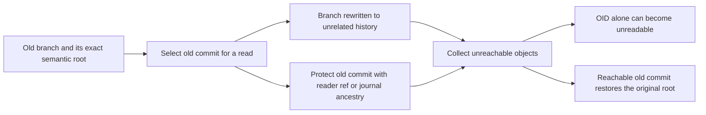

# RT-23 — Retain exact Git snapshots across history rewrites

An exact commit OID preserved identity but did not keep the object reachable. After a branch rewrite and local collection, both Git ref backends removed the old commit when no ref retained it. A reader ref or a retained journal ancestry restored the exact old semantic root through the same collection.

## Question and method

An operation may pin the exact commit for a multi-file read or review. If the branch moves to an unrelated history, an unreferenced object can survive briefly and then disappear. This study measures that distinction with ten disposable Git repositories across loose files and reftable. The [single-ref publication journal](RT-23-SINGLE-JOURNAL-REF-2026-11-24.md) provides the comparison with retaining a semantic commit as a journal parent.

Each repository starts with a branch selecting one closed declaration. The controller writes a different closed tree as an unrelated commit and replaces the branch by compare-and-swap. Reflogs are disabled and verified empty, and no other ref reaches the old commit unless the case deliberately creates one. Before collection the precise old OID still reproduces the original root in every case. The controller runs `git gc --prune=now` after ref mutations finish and checks each remaining repository with `git fsck --full`.



A reader starting from the current branch can verify the expected branch and create its private reader ref in one native Git transaction. A historical reader that already requests a specific OID can instead create a ref to that still-present object without asserting that it remains current. The difference is exercised by acquiring both types after the rewrite. The journal variant creates a separately retained Git commit with the old snapshot as a parent.

## Results

| Backend and read policy | After rewrite and collection | After final retention ref is gone |
| --- | --- | --- |
| files/journal-parent | Exact old root | Missing commit |
| files/late-explicit-lease | Exact old root | Missing commit |
| files/late-verified-lease | Missing commit | Missing commit |
| files/oid-only | Missing commit | Missing commit |
| files/verified-lease | Exact old root | Missing commit |
| reftable/journal-parent | Exact old root | Missing commit |
| reftable/late-explicit-lease | Exact old root | Missing commit |
| reftable/late-verified-lease | Missing commit | Missing commit |
| reftable/oid-only | Missing commit | Missing commit |
| reftable/verified-lease | Exact old root | Missing commit |

The late verified acquisition fails because the branch no longer points at the observed commit. The late explicit acquisition succeeds while the requested historical object still exists. Trying to create a reader ref once collection removes the object fails. With two reader refs, removing the first leaves the old commit and root readable. Removing the last lets collection delete the old commit. Removing the single journal ref has the same retention effect when no other ancestry reaches the old commit.

Four non-local clean clones cover the lease and journal variants across both backends. Each default clone omits the retained old history. Explicitly fetching the corresponding ref recovers the exact old root. The new branch remains readable in all source repositories throughout the test.

## Implications for implementation choice

A snapshot read through Git needs both exact identity and a retention contract. Compare-and-swap acquisition can require the selected branch to remain current. A separate historical API can retain an explicitly requested object where it still exists. Per-reader refs support independent lifetimes, while journal ancestry retains published history for the journal's entire retention period. Clone and fetch policy must account for private refs if remote readers depend on them.

The test uses controlled mutations and collection in disposable local repositories. It leaves authorization and expiry of leases, abandoned readers, protection against uncoordinated ref writers and aggressive concurrent collection, remote server policy, power-loss durability and long-running retention costs open. Git maintenance is deliberately scheduled outside the ref writes.

## Reproduce

Use CPython 3.12.14 and Git 2.52.0 on Linux from the repository root. The runner initializes each fixture in a new temporary directory.

```sh
fixture=research/toolchain-and-collaboration/RT-23/PINNED-GIT-RETENTION-01
output=$(mktemp)
python3 "$fixture/run.py" --output "$output"
cmp "$fixture/evidence.json" "$output"
python3 "$fixture/chart.py"
```

[Runner](PINNED-GIT-RETENTION-01/run.py) · [Evidence ledger](PINNED-GIT-RETENTION-01/evidence.json) · [Exact ref verification](RT-23-DEPENDENT-REF-VERIFICATION-2026-11-24.md)
