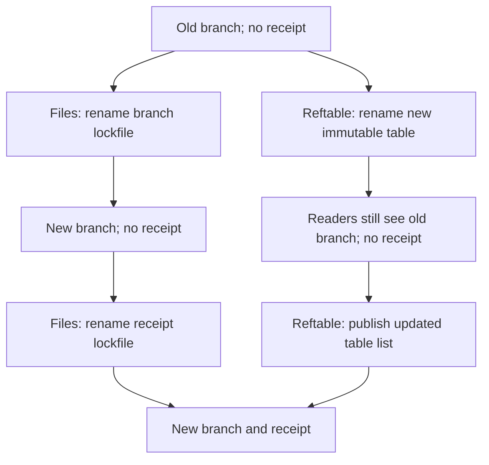

# RT-23 — Observe branch and receipt during Git ref commit

**Evidence** — Six deterministic commit-phase cases on Git's files and reftable reference backends.

## Question and method

An exact-tree publisher updates a branch and creates its operation receipt through the same Git transaction. Does a concurrent reader see both updates together? Does the answer change if the publisher stops after the first storage rename? Git's documentation allows readers to see a subset of a multi-ref modification. The earlier RT-23 recovery work treated power loss and concurrent observers as open boundaries. [Exact-tree recovery](RT-23-EXACT-TREE-COMMIT-RECOVERY.md) · [Prepared-phase process interruption](RT-23-GIT-PREPARED-REF-CRASH-2026-11-24.md) · [Git update-ref](https://git-scm.com/docs/git-update-ref)

Each temporary repository uses the same closed typed tree and exact prepared commit. One Git process receives an update for the branch with its expected old OID and a create for the receipt. A test-only library calls the real Linux C-library rename and then stops only that fixture process after its first successful rename to the named destination. The controller waits for the stopped state, reads the refs both separately and through one `git for-each-ref` invocation, and allows the process to resume or stops it permanently with `SIGKILL`. The library does not change the operation's arguments or the filesystem result of rename.

Before the controlled probe, a native `strace` run identified the commit writes for an equivalent two-ref transaction. The loose files backend renamed the individual ref lockfiles in command order. Reftable first renamed a new table into place and then updated the table-list pointer, with an additional compaction observed in the exploratory run. The tested stop at the table-list pointer targets its first successful rename.



In the fixture the branch update is the first published loose ref. The reftable reader resolves refs through the currently published table list. All readings in a paused phase complete while the writer remains stopped.

## Results

| Backend and stopping point | Reader sees during the cut | Final view after the chosen action |
| --- | --- | --- |
| Files, branch rename, resume | New branch with no receipt | New branch and receipt |
| Files, receipt rename, resume | New branch and receipt | New branch and receipt |
| Files, branch rename, kill | New branch with no receipt | New branch with no receipt |
| Reftable, new table rename, resume | Old branch with no receipt | New branch and receipt |
| Reftable, table-list rename, resume | New branch and receipt | New branch and receipt |
| Reftable, new table rename, kill | Old branch with no receipt | Old branch with no receipt |

The single-command enumeration and the independent reads agree at every stable stop. The files checkpoint before receipt rename gives a real mixed state even to one enumeration command. The existing inspector returns `stale` at that point. Allowing the publisher to resume produces `published`. Killing it there leaves a moved branch and no completed receipt. The candidate tree still passes exact semantic reconstruction. This distinguishes the absence of a receipt from proof that the branch did not move.

In the tested reftable cases the first table-list publication exposes both updates. A caller making two independent observations across the transaction can still combine the old branch and new receipt. The ledger records one such cross-boundary pair for each successful run. Reftable also retains its separate crash-retry lock behavior at the earlier prepare stage.

These results constrain which facts a recovery API may infer from individual ref reads. A backend-aware reader must pin a consistent observation where the storage model supports it, or retain an unresolved state when the observations cannot identify one exact operation. Ref visibility under an interrupted process differs from durability under a machine crash. The comparison covers Linux, local disposable repositories, two native ref backends and these precise stopping points. It leaves graph publication recovery policy, arbitrary storage layouts, remote visibility and filesystem power-loss behavior open.

## Reproduction

Use Git 2.52.0, CPython 3.12.14 and GCC 14.2.0 on Linux. The controller launches the fixture process directly and uses OS child-stop notification. It needs no hook edits or instrumentation in a real repository.

```sh
study=research/toolchain-and-collaboration/RT-23/REF-VISIBILITY-01
python3 -B "$study/run.py" --output /tmp/rt23-ref-visibility.json
cmp "$study/evidence.json" /tmp/rt23-ref-visibility.json
(cd research/PROTOTYPES/DEPENDENCY-GRAPH-01 && python3 -B -m unittest \
  tests.test_rt23_ref_generation tests.test_rt23_commit_recovery tests.test_rt24_tree_bound_cip)
```

The [harness](REF-VISIBILITY-01/run.py) compiles the small [test instrument](REF-VISIBILITY-01/pause_rename.c) in a temporary directory. The [ledger](REF-VISIBILITY-01/evidence.json) records exact ref pairs, process status, inspection outcomes and the typed candidate identity.
