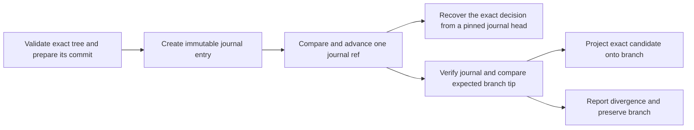

# RT-23 — One Git journal ref for recoverable publication

A single Git journal ref recovered the exact LLMLang publication on both Git ref backends after the publisher was killed. Ordinary Git readers saw the old branch until a separate projection updated it. After another writer moved the branch, projection reported a conflict and preserved that writer's commit.

## Question and fixtures

A paired branch and operation-receipt transaction can expose a moved branch with no receipt on Git's loose files backend. Compare the existing paired transaction with a candidate that uses an exact journal commit as the publication authority and updates the ordinary branch afterwards. Here, projection means writing that exact candidate to an expected branch tip after the journal accepts it. [Paired ref visibility](RT-23-REF-COMMIT-VISIBILITY-2026-11-24.md)

The runner prepares an exact Git commit with the closed typed-tree importer. The journal commit stores a canonical record of the operation, candidate commit, selected tree, semantic root, ordered parents and destination branch. Its first parent is the previous journal entry. Its second parent makes the candidate a reachable Git object. Publication advances one journal ref by compare-and-swap against the expected prior entry. Recovery pins the journal head and follows first parents to find the exact operation and validate its candidate. Branch projection checks the destination tip and verifies the journal ref in the same native Git ref transaction when writing the branch.



Nine disposable SHA-1 repositories exercise loose files and reftable. The existing Linux test instrument stops the native Git process immediately after a selected successful storage rename. The controller reads the stopped state and kills the Git process. For loose files the stop targets the individual ref path. For reftable it targets the published table list, with a separate control targeting the creation of a new table before list publication. These are process stops with the filesystem and operating system still live.

## Results

| Backend and stop | Branch | Receipt | Paired inspection | Journal inspection |
| --- | --- | --- | --- | --- |
| files/journal-kill-retry | Base | Absent | retryable | published |
| files/paired-kill | Candidate | Absent | stale | undecided |
| reftable/journal-kill-retry | Base | Absent | retryable | published |
| reftable/paired-kill | Candidate | Present | published | undecided |
| reftable/unpublished-table | Base | Absent | retryable | undecided |

Each strategy uses its own inspection column for its authoritative result. The other column shows what a reader applying the alternative policy infers from the same state. `published` in the journal column means the operation and its exact semantic candidate are recoverable from the journal, even while ordinary Git clients see the previous branch tip. No legacy receipt ref is written in the journal strategy.

After killing the journal writer following publication, a retry projected the exact candidate and a second retry returned `already-current` on each backend. The branch contained the base and exactly one published candidate. In two separate cases an intervening branch update resulted in `branch-conflict` while the journal still returned `published`. Before reftable table-list publication, the new table was invisible to recovery and the abandoned table-list lock was still present.

A branch-only writer could also install the prepared candidate's exact OID without a journal entry. In that case journal inspection returned `undecided`. A second producer attempting to advance the journal from the original predecessor lost the compare-and-swap on each backend. Reusing an operation key with a different candidate returned `journal-conflict`. After a subsequent journal decision, both historical decisions were recoverable in a clean clone after explicitly fetching the journal ref. The default clone omitted that ref.

## Implementation boundary

The journal ref gives a single publication point within this process-crash fixture. Ordinary branch visibility can lag it, so clients need distinct states for publication, branch projection and a branch conflict. Keeping the native paired transaction avoids that delayed branch view in the tested reftable case. It leaves the mixed loose-files state previously observed. Journal-based history uses one additional commit per decision, a dedicated fetched ref and first-parent lookup. The experiment measures outcomes only.

The fixture assumes a trusted journal writer and a protected, retained history. Worktree state, authenticated approvals, arbitrary external journal rewrites, multiple authority refs, recovery of abandoned locks, long-history lookup and compaction, remote visibility, filesystem fsync and power-loss behavior remain open. Production selection still depends on the synchronized-commit and Git interoperability requirements.

## Reproduce

Use Linux with Git 2.52.0, GCC 14.2.0 and CPython 3.12.14 from the repository root.

```sh
fixture=research/toolchain-and-collaboration/RT-23/SINGLE-JOURNAL-REF-01
output=$(mktemp)
python3 "$fixture/run.py" --output "$output"
cmp "$fixture/evidence.json" "$output"
python3 "$fixture/chart.py"
```

[Runner](SINGLE-JOURNAL-REF-01/run.py) · [Evidence ledger](SINGLE-JOURNAL-REF-01/evidence.json) · [Test-only rename checkpoint](REF-VISIBILITY-01/pause_rename.c) · [Exact-tree preparation and recovery](RT-23-EXACT-TREE-COMMIT-RECOVERY.md)
