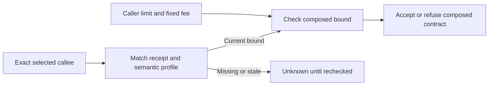

# RT-24 caller contracts and independent implementation changes

An unchanged caller body can require new validation when its selected callee changes. For a caller that adds a fixed fee to its callee's result, Lean checks that an exact callee output bound and a sufficient caller limit entail the composed bound. The finite replay compares reuse based on caller body with reuse bound to the exact callee and semantic profile.

## Candidate contract rule

The caller owns its public limit. The callee provides a bound over its selected function. Their edits may be prepared independently. On integration, the proof subject must bind the caller contract and exact selected callee, then check that the callee's evidenced maximum plus the fee fits the caller limit. Missing or stale evidence yields unknown. A new checked bound can then admit or refuse the composed relation. [Native contract and implementation merges](RT-24-CONTRACT-BODY-MERGES-2026-11-25.md)



The Lean theorem supplies a bound for an arbitrary natural-number function with a checked receipt tied to that function. A companion result constructs a bound for a clamped helper. The counterexample proves that a bound of two remains valid for a helper that clamps at two and fails for a helper that clamps at five. The composition theorem uses no axioms. The two clamped-helper results depend on `propext`. [Proof and axiom receipt](CALLER-CONTRACT-COMPOSITION-01/Bounds.lean) · [Axioms](CALLER-CONTRACT-COMPOSITION-01/axioms.txt)

## Finite replay

The model crosses nine prior and current callee ceilings, five fees, thirteen caller limits and two receipt availability states. A direct observation oracle checks 17 values per context. That input set covers all saturation points in this fixture.

| Gate | Decisions | False acceptances | False refusals | Unknown |
| --- | ---: | ---: | ---: | ---: |
| Reuse by caller body alone | 10,530 | 600 | 600 | 5,265 |
| Bind exact callee and semantic profile | 10,530 | 0 | 0 | 9,945 |

Rechecking with a current receipt resolves all 10,530 contexts and matches the oracle. In one control, changing the callee clamp from two to five invalidates the old support for a caller limit of three and fee one. The exact gate returns unknown until the new receipt is checked, then refuses the contract. A receipt for the right provider under a different semantic profile also yields unknown.

The result covers a bound over pure natural-number functions. Real effect traces, recursion, multiple providers, authenticated proof receipts and source-to-artifact correspondence need separate checks. [Exact opaque receipt scope](../../packages-and-ecosystem/RT-12/RT-12-OPAQUE-IMPLEMENTATION-EVIDENCE-2026-11-25.md)

## Reproduce

Use Lean 4.36.0 at `611c117bfaf7b7ae1cfcf246ce6fba31e8f509e9` and CPython 3.12.14. With Python hash seeds 37 and 71, evidence SHA-256 is `8d52aefb07cf8f0cf64c75228260d1432097af8c7b95c2d240597582abd7b179`. [Evidence ledger](CALLER-CONTRACT-COMPOSITION-01/evidence.json)

```sh
study=research/toolchain-and-collaboration/RT-24/CALLER-CONTRACT-COMPOSITION-01
lean -DwarningAsError=true "$study/Bounds.lean" > /tmp/rt24-caller-axioms.txt
cmp /tmp/rt24-caller-axioms.txt "$study/axioms.txt"
LC_ALL=C PYTHONHASHSEED=37 PYTHONDONTWRITEBYTECODE=1 \
  python "$study/check.py" > /tmp/rt24-caller-contract.json
cmp /tmp/rt24-caller-contract.json "$study/evidence.json"
```
