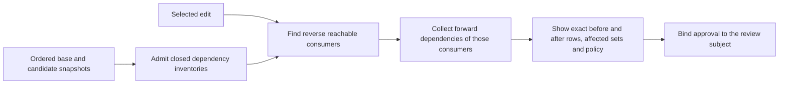

# RT-24 Review subjects for semantic change sets

**Issue** [#334](https://github.com/aivibeflow/LLMLang/issues/334)

A semantic review should show the exact edit, the consumers it may affect, and the dependency context that makes it meaningful. A change-set label survives revisions and is convenient for navigation. Approval needs stronger binding. This study compares four subjects for authorizing a review of one operation-binding change and checks what a later reviewer would need to examine again. [Typed tree diff](RT-24-TYPED-TREE-DIFF.md)

## Candidate projection

A snapshot is an explicit map from declared slots to typed records with dependency edges. Each edge goes from a consumer to an input. The review focuses on the slot selecting the implementation of the compute operation. For each ordered snapshot, the candidate computes the reverse reachable set from that slot to capture may-affected consumers, then follows their forward dependencies to get the facts those consumers depend on. The review capsule includes before and after rows for the union of both scopes, the affected sets, the selected change and the review policy. An absent row on one side is explicit.

The comparison uses four subject digests. The label digest identifies the slot alone. The direct digest binds the edited slot's exact values and policy. The closure digest adds the affected consumers and required dependency rows. The full digest binds both entire snapshot roots, their order, the focus and policy. Full-root binding has a smaller dependency-completeness burden at review reuse, but any unrelated root change requires reapproval. Scoped binding can preserve review work after unrelated edits, conditional on complete typed dependency inventory and an approval policy that permits this scope.



The projection computes each side independently. A newly added indirect consumer appears as an after-only row, and a removed consumer remains visible as a before-only row. Review reuse does not give approval for other change-set edits. Publication of a whole candidate still needs its own full validation and review requirements.

## Controls and observations

The synthetic graph changes an operation binding from addition to subtraction. A client depends on the binding and an entry depends on the client. Both implementations depend on the runtime word type. Documentation is unconnected. The [ledger](CHANGESET-REVIEW-SCOPE-01/evidence.json) records all input graphs, exact capsules and digests, and eleven decision outcomes against one original approval.

| Later context | Label only | Direct edit | Closed review | Full roots |
| --- | --- | --- | --- | --- |
| Exact or reordered encoding (2) | Reuse | Reuse | Reuse | Reuse |
| Unrelated document edit in either snapshot (2) | Reuse | Reuse | Reuse | Review again |
| Add an indirect consumer or remove an existing one (2) | Reuse | Reuse | Review again | Review again |
| Change selected provider body or shared runtime dependency (2) | Reuse | Reuse | Review again | Review again |
| Swap snapshot roles or change review policy (2) | Reuse | Review again | Review again | Review again |
| Missing provider row (1) | Refuse | Refuse | Refuse | Refuse |

The last row stops during graph admission before any subject is generated. The closure retains both provider rows when the selected implementation changes. It detects an indirect new consumer even though the edited binding bytes stay equal to those previously reviewed. It also preserves the two documentation-only review decisions. These are exact categorical outcomes for declared graphs. The fixture measured no reviewer time or interaction costs.

## Bounds and reproduction

This proposal assumes that dependency rows are complete within the fixture. A graph with a silently omitted edge requires independent completeness checks and cannot be justified by a projection digest alone. Review scopes for representation migration, dynamic dependencies, shared resources, concurrent publication, authenticated authorship and multi-edit composition remain open. This experiment has no human review observations and confers no authority to publish. [Conflict resolution replay](RT-24-CONFLICT-RESOLUTION-REPLAY-2026-11-24.md)

Run with CPython 3.12.14 from the repository root. The branch baseline is `b076f3abbb798f7c9753236a366aea595654f535`. Hash seeds 1 and 2 produced byte-identical ledgers. Relative links and Mermaid source structure were checked. GitHub visual rendering was not manually verified.

```sh
study=research/toolchain-and-collaboration/RT-24/CHANGESET-REVIEW-SCOPE-01
PYTHONHASHSEED=1 python -B "$study/run.py" >/tmp/llmlang-change-review.json
cmp "$study/evidence.json" /tmp/llmlang-change-review.json
```
