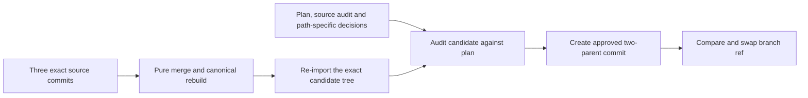

# RT-24. Mandatory change-plan audit for a native merge candidate

This experiment connects the pure three-way merge, the RT-20 Change Impact Plan auditor and native Git publication. The fixture combines one independent parent edit with a shared-caller migration. The four consumer paths preserve the old target, migrate to the new target, use an explicitly adapted caller and use a forked caller. [Issue #321](https://github.com/aivibeflow/LLMLang/issues/321) · [Pure merge coordinator](RT-24-GIT-CORE-COORDINATOR-2026-11-25.md) · [CIP v2 diff enforcement](../RT-20/RT-20-CANDIDATE-SEMANTIC-DIFF.md)

The gate requires an approved plan and exact target tree. It verifies the native merge ancestry, rebuilds from the three source trees, independently imports the selected candidate and checks the source-derived reverse evidence. The eight decisions identify the baseline sites and the exact path-specific output slots. The check verifies actual selected consumer paths and all planned edge deltas before it creates a two-parent commit and attempts a branch compare-and-swap.



## Results

Two of twelve native cases publish. The first preserves the independent parent edit and verifies the four intended consumer paths. A revised plan changes the caller outputs. The earlier approved tree, plan and source commit cannot authorize the new bytes. Rebuilding from the revised source commit and generating a new plan binds a different tree, semantic Snapshot and diff. Its exact two-parent commit is published. [Plan IDs, trees, commits and refusals](CIP-COORDINATOR-01/evidence.json)

Ten controls refuse a missing plan or reverse audit, a missing baseline call site, a missing consumer-path decision, an unapproved edge, a wrong approved tree, a stale semantic Snapshot binding, an incomplete inventory, wrong ancestry and a tree that the selected parents do not produce. All refusals preserve the previous branch head. The scoped decisions rely on fixture compatibility evidence. The audit checks exact materialization and coverage of the declared calls.

The candidate input language remains the closed declaration fixture. Production compatibility judgments, dynamic caller discovery, authorization and crash recovery require their separate gates.

## Replay

Source baseline `5025217` on `research/all`. Replay used Git 2.56.1 and CPython 3.12.14 on Linux. Each test operates on a disposable repository using branch `research/all`. Run from the repository root.

```sh
data=research/toolchain-and-collaboration/RT-24/CIP-COORDINATOR-01
receipt=$(mktemp)
python -B "$data/run.py" "$receipt"
cmp "$data/evidence.json" "$receipt"
rm "$receipt"
```
