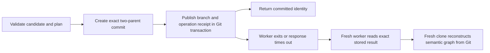

# RT-24. Recover exact CIP publication after process loss

This experiment composes the mandatory Change Impact Plan gate with the exact-tree Git receipt protocol. After validating the three source commits, exact candidate tree and all call-site decisions, publication creates a two-parent commit. One native Git ref transaction checks the old branch head, updates the branch and creates a receipt ref for the exact operation. [Issue #321](https://github.com/aivibeflow/LLMLang/issues/321) · [Mandatory CIP gate](RT-24-CIP-COORDINATOR-2026-11-25.md) · [Exact acceptance and retry](../RT-20/RT-20-EXACT-TREE-ACCEPTANCE-2026-11-25.md)

The receipt's commit binds the operation key, common base, both parents, candidate tree, semantic Snapshot and plan ID. A fresh worker can recover the exact result when that record and the actual commit subject match. A different request with the same key is refused. The replay reads the receipt and leaves later branch changes intact.



## Results

| Controlled failure or race | Observed result |
| --- | --- |
| Worker exits before the Git ref transaction | Branch and receipt remain absent from the proposed update. A fresh worker publishes the exact candidate once. |
| Worker exits after the transaction and before returning a result | Fresh retry returns the original commit from the receipt. |
| Client times out while the completed worker is paused before response | Fresh retry also returns the original commit. |
| An independent writer changes the branch after validation | Ref transaction refuses the stale branch update and creates no receipt. A fresh retry still refuses the stale head. |

In all three accepted histories, the branch advances before the recovery call. Recovery returns the retained commit without moving the head and refuses reuse of the operation key for a revised candidate. Three fresh `--no-local` clones reconstruct the exact candidate tree, semantic Snapshot and plan through normal Git history. The original in-memory semantic store is absent in every fresh process and clone. [Exact recovery and clone ledger](CIP-RECOVERY-01/evidence.json)

The replay tests process interruption before and after a completed ref transaction. It does not kill a writer during the internal Git ref-store commit. Remote durability, concurrent ref visibility, receipt retention, approval authentication, arbitrary source profiles and production deployment remain open.

## Replay

Source baseline `6bd870e` on `research/all`. Replay used Git 2.56.1, CPython 3.12.14 and Linux. The fixture uses disposable SHA-1 repositories with branch `research/all`. Run from the repository root.

```sh
data=research/toolchain-and-collaboration/RT-24/CIP-RECOVERY-01
receipt=$(mktemp)
python -B "$data/run.py" "$receipt"
cmp "$data/evidence.json" "$receipt"
rm "$receipt"
```
