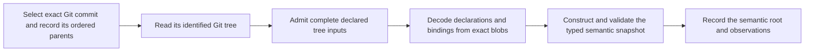

# RT-24 — Map exact Git revisions to semantic snapshots

Scope is PLAN §4.2 and [#320](https://github.com/aivibeflow/LLMLang/issues/320), starting from `5c512275257a35ce867e3b2ecd540c3ac6dc04fd` on `research/all`.

A Git commit identifies its tree and history, including its ordered parents. A Git tree identifies the exact tracked names, modes, and object references within one Git object format. A semantic snapshot identifies the admitted program meaning represented by those inputs. LLMLang needs the exact commit or tree for provenance and the typed snapshot for semantic identity.



The closed importer recognizes one required semantic declaration and an optional documentation file. The baseline binds an operation call to a provider that adds one. The changed binding selects a provider that subtracts one. Declaration formatting and documentation are outside the semantic projection. Unknown tracked entries and missing semantic inputs fail admission. The actual importer reads Git object bytes, so changes in the uncommitted worktree cannot replace the source of the reconstruction.

## Native observations

The runner builds eight commits in each of a SHA-1 and a SHA-256 Git repository. It also checks a missing semantic declaration, an undeclared path, and an uncommitted file edit against the pinned tree.

| Change from the baseline or equal-tree comparator | Commit ID | Tree ID | Semantic root |
| --- | --- | --- | --- |
| Change only the commit message | changes | same | same |
| Edit documentation or reformat the declaration | changes | changes | same |
| Change the bound implementation | changes | changes | changes |
| Restore the baseline tree after the binding change | changes | same | same |
| Reverse the two parents of an equal-tree merge | changes | same | same |
| Change Git object format for any corresponding revision | changes | changes | same |

The baseline returns `[0, 1, 2]` on `[-1, 0, 1]`. The changed binding returns `[-2, -1, 0]` in both formats. All 48 interpreted calls match the declared fixture expectations. The two rejected inputs in each format produce no semantic root. The claim is deliberately narrower than general source correspondence.

An object cache scoped to an admitted immutable tree can reuse an exact reconstruction across commits sharing that tree. A comparison of semantic roots can recognize more cases, such as formatting edits or corresponding content in different Git formats. A receipt about the selected parents or about exact tracked bytes still needs the commit or tree identity, respectively. This complements the [canonical Git layout study](RT-24-CANONICAL-GIT-LAYOUTS-2026-11-24.md), which varies physical placement, and the [clean-clone replay](RT-24-CLEAN-CLONE-CLI-2026-11-25.md), which verifies retrieval and reconstruction.

## Reproduce and limits

Use Python 3.12.14 and Git 2.52.0. The [runner](COMMIT-TREE-SEMANTIC-ROOT-01/run.py) pins the typed prototype sources, creates temporary native Git repositories with fixed commit metadata, and records exact OIDs and semantic roots in the [ledger](COMMIT-TREE-SEMANTIC-ROOT-01/evidence.json).

```sh
fixture=research/toolchain-and-collaboration/RT-24/COMMIT-TREE-SEMANTIC-ROOT-01
LC_ALL=C PYTHONHASHSEED=1 python3 -B "$fixture/run.py" > /tmp/llmlang-git-root-mapping.json
cmp "$fixture/evidence.json" /tmp/llmlang-git-root-mapping.json
```

The table captures the categorical comparisons without a performance chart. Mermaid syntax was inspected directly. This fixture establishes the identity mapping under one closed import profile. A canonical full-repository codec, authorization, and production dependency completeness remain open.
