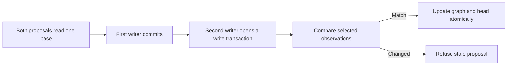

# RT-24. Optimistic validation of concurrent graph edits

Which edits to a graph prepared on the same revision may both commit? The experiment uses directed acyclic dependency graphs whose edges must connect enabled nodes. An edge addition requires a missing edge, two enabled endpoints and no reverse path. A node may be disabled when it has no incident edges. These predicates capture both negative lookups and negative graph queries. [Issue #334](https://github.com/aivibeflow/LLMLang/issues/334) · [Lean independence and final validity](RT-24-INDEPENDENT-MERGE-GATE-2026-11-25.md)

Every fixture starts two independent SQLite WAL connections. Both capture their proposals in read transactions and close those transactions before either attempts publication. Each validation and update runs inside one `BEGIN IMMEDIATE` write transaction. A barrier and an event order the two writers, and the replay tests both commit orders. The current graph is checked by a separate Python oracle using endpoint validation and topological removal.

- Whole-head compare-and-swap checks the observed head version. Any intervening accepted write causes the second edit to be refused.
- Write-only compare-and-swap checks the prior value of the written edge or node. Nothing else can veto its publication.
- Exact projection checks the prior value of the write target together with endpoint states, incident-edge presence or reverse reachability as appropriate. It re-evaluates those predicates on the current transactional view, then publishes only if the observed projections still agree.



## Results

Four backbone lengths, six edit pairs, both commit orders and three policies give 144 native schedules. The 48 schedules for each policy include duplicate writes, independent writes, unchanged overlapping reads, endpoint changes, new incident edges and a newly reachable reverse path.

| Commit gate | Incorrect admissions | Unnecessary refusals | Invalid final graphs |
| --- | ---: | ---: | ---: |
| Whole head | 0 | 16 | 0 |
| Write target | 24 | 0 | 24 |
| Exact projection | 0 | 0 | 0 |

For example, the initial graph has a path from 0 to 1. Adding 1→2 and adding 2→0 are each valid against the base. The second addition would close a cycle in either order. Its write target is still absent, and the reverse path now exists. The exact check refuses that write. When two proposals add distinct edges into the same enabled node and neither changes the other's reverse reachability, the exact check admits both. [Raw deterministic observations](CONCURRENT-GRAPH-01/evidence.json)

The result supports transactionally rechecking semantic predicates for these two edit types. The predicate must cover absent records and newly matching paths. A list of rows previously returned by a negative query would be empty and miss those changes. Inputs such as replacement identities, policy epochs, side-effectful validation, parallel distributed publication, crash recovery and general projection completeness remain outside this experiment. The schedule tests force each commit order and do not measure lock contention or retries.

## Replay

The source baseline is `74f69eb` on `research/all`. The replay used CPython 3.12.14 and SQLite 3.53.1 on Debian 13 x86-64. Run from the repository root.

```sh
data=research/toolchain-and-collaboration/RT-24/CONCURRENT-GRAPH-01
receipt=$(mktemp)
python -B "$data/run.py" "$receipt"
cmp "$data/evidence.json" "$receipt"
rm "$receipt"
```
