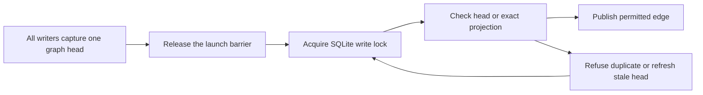
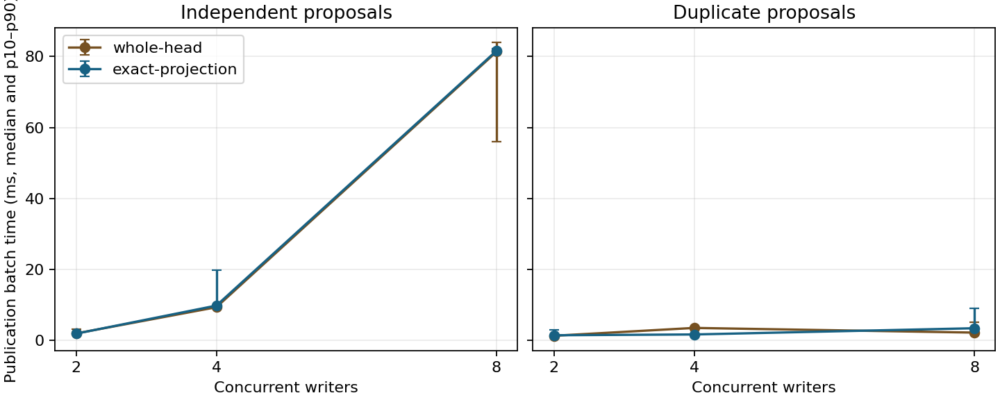

# RT-24 concurrent semantic edit publication costs

An exact projection can preserve independent edits prepared on the same graph head and refuse duplicates. Whether it reduces elapsed time depends on the publisher and lock scheduler. This pilot measures actual SQLite writer contention for whole-head validation with refresh and for exact projection validation. It reuses the original projection model, endpoint checks and reverse reachability query. [Prior two-writer validation study](RT-24-CONCURRENT-GRAPH-2026-11-25.md)



Two, four or eight writer threads open independent WAL connections to a fresh database containing a 192-edge backbone. Each proposed edge targets the backbone. The independent workload uses distinct source nodes. The duplicate workload gives every writer the same edge. Every initial read transaction completes before the launch barrier opens. Write attempts then run in the SQLite scheduler's observed order. The exact route checks the current write target, endpoints and cycle predicate under the same write transaction. The whole-head route refreshes a stale proposal before trying a new write. A fresh invalid proposal is refused.

The batch timer runs from launch barrier release to receipt of all writer outcomes. Each attempt records time spent entering `BEGIN IMMEDIATE` and time from acquisition through commit or rollback. The wait measure includes SQLite and thread scheduling. Continued validation when a whole-head proposal is stale also consumes time outside the held transaction. The original independent graph oracle checks the final edges, validation and published version.

## Results

Ten blocks randomize the 12 profiles on logical CPU 4 of AMD EPYC 9V74, Linux 6.18.57, CPython 3.12.14 and SQLite 3.53.1. WAL uses full synchronous mode. No cgroup CPU periods were throttled. All 120 batches preserve the expected graph. The 560 proposals give 340 committed edges and 220 duplicate refusals across the benchmark.

| Profile | Writers | Whole-head median batch, ms | Exact median batch, ms | Median stale-head refreshes |
| --- | ---: | ---: | ---: | ---: |
| Independent | 2 | 2.01 | 1.95 | 1 |
| Independent | 4 | 9.40 | 9.85 | 3 |
| Independent | 8 | 81.33 | 81.61 | 7 |
| Duplicate | 2 | 1.36 | 1.50 | 1 |
| Duplicate | 4 | 3.57 | 1.73 | 3 |
| Duplicate | 8 | 2.25 | 3.48 | 7 |



The exact route uses one write attempt per proposal. It has zero refreshes. In the eight-writer independent workload, the median longest individual lock wait is approximately 80 ms for both policies, and both complete about 98 commits per second over the batch window. Exact projection avoids stale-head work and leaves this workload's median batch duration close to the whole-head route. The duplicate result changes with the writer count. The measurements are scoped to this one-CPU, local SQLite fixture and SQL query. Distributed merges, representative collaboration, multiple edit kinds, authenticated publication and different lock schedulers remain open. [Raw trials](CONCURRENT-PUBLICATION-BENCHMARK-01/evidence/samples.csv) · [Distributions](CONCURRENT-PUBLICATION-BENCHMARK-01/evidence/summary.json) · [Configuration](CONCURRENT-PUBLICATION-BENCHMARK-01/evidence/config.json)

## Reproduction

Use CPython 3.12.14 with SQLite 3.53.1 and Matplotlib 3.10.8. Choose a CPU within the runner's permitted affinity. Timing and write order vary across trials.

```sh
study=research/toolchain-and-collaboration/RT-24/CONCURRENT-PUBLICATION-BENCHMARK-01
build=$(mktemp -d)
LC_ALL=C PYTHONHASHSEED=37 PYTHONDONTWRITEBYTECODE=1 python "$study/measure.py" \
  --cpu 4 --trials 10 --seed 20261125 --output "$build/evidence"
LC_ALL=C MPLBACKEND=Agg MPLCONFIGDIR="$build/plot-cache" python "$study/summarize.py" \
  --evidence-dir "$build/evidence"
```

[Collector](CONCURRENT-PUBLICATION-BENCHMARK-01/measure.py) · [Summary and chart generator](CONCURRENT-PUBLICATION-BENCHMARK-01/summarize.py)
