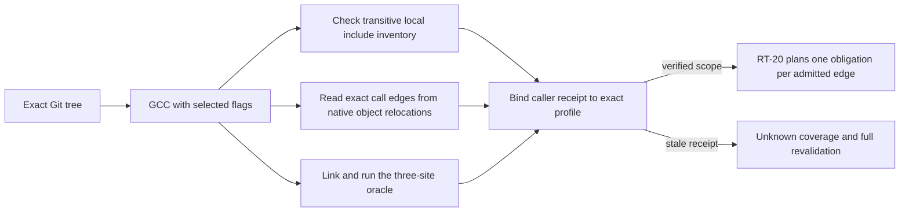

# Bind caller completeness to the selected native build configuration

The merge coordinator needs a complete set of calls affected by a provider change before it can ask the RT-20 planner for dispositions. A prior RT-24 experiment separates a signed reverse-lookup assertion from rechecking explicit source calls. This experiment asks what the assertion must identify when a caller's source bytes stay constant across a preprocessor configuration and an included route-table edit. [Reverse audit authority](RT-24-REVERSE-AUDIT-AUTHORITY-2026-11-24.md) · [RT-20 planner scope](../RT-20/RT-20-LLM-PATCH-PLANNING-AND-HASH-PROPAGATION.md)

## Fixture and observation

A small C program has three named sites. Each site contains at most one direct call under any configuration. A dispatcher header includes a second header with provider aliases. Two real Git commits differ only in that second header. Eight combinations of the Boolean `MODE`, `AUDIT`, and `EXTRA` flags choose the conditional call paths. GCC compiles the caller separately at `-O0` and `-O2`, for 32 native builds. Four provider functions return distinct integers, and the driver reports each site's numeric result. The optional disabled site returns zero.

For each build, the fixture verifies the compiler's repository-local dependency list against the expected inventory. It reads exact x86-64 call relocations from the object and compares each named site and target with an independently expressed table of the branch choices. It also links and executes a fresh binary and checks all three result values. The producer receipt binds the exact Git tree, compiler target, compiler and analyzer tool fingerprints, actual caller compilation arguments, and each dependency's path, Git blob and SHA-256 digest. The harness creates a scoped audit for each of the four possible affected provider identities and runs the existing RT-20 planner. Provider and caller addresses are fixture-projected identities.



The policies compare a cached default profile keyed by caller source, the same baseline adapted to the selected flags, the union over all admitted profiles sharing the selected tree and optimization level, and the exact selected profile. The union protects against missing active targets across the enumerated configurations but cannot distinguish the currently selected caller obligations. Exact coverage requires either building or reusing a result under the complete profile key.

## Observed coverage and cache replay

| Coverage policy | Exact profiles | Missing call edges | Excess call edges |
|---|---:|---:|---:|
| Caller source only | 2 | 56 | 40 |
| Caller source and flags | 18 | 24 | 24 |
| All profiles in the selected tree | 0 | 0 | 80 |
| Exact selected profile | 32 | 0 | 0 |

Counts sum omissions and excess per build across the 32 profile cases. The planner lists unresolved obligations for every edge it receives. When given a fixture audit claiming a truncated or overbroad projection is supported, its planned obligations inherit the omissions or excess. Recognizing the limits of observation is a separate responsibility from constructing actions from admitted evidence. All these edge sets still require dispositions that the fixture leaves unresolved.

| Receipt swap | Replays | Equal edge sets | Accepted by edge-only gate | Accepted by profile gate |
|---|---:|---:|---:|---:|
| Other Git revision | 32 | 4 | 4 | 0 |
| Other optimization level | 32 | 32 | 32 | 0 |

The changed include can be dormant for selected configurations, and both optimization levels emit the same direct edge set throughout this fixture. The profile check rejects every cross-profile receipt even when the comparator sees identical edge content. The planner receives unknown coverage and adds full revalidation in all 64 replay cases. A separately demonstrated equivalence between profile keys could justify reuse. Equal observed edges alone carry no such authority.

## Scope and replay

The experiment supports making build configuration and transitive source membership explicit before reverse-lookup evidence can drive semantic merge planning. It observes direct single-call C wrappers on Linux x86-64. It does not establish coverage of indirect calls, dynamically loaded or generated code, optimizations that remove or inline calls, the correctness of a general C-to-SPG importer, trusted audit delegation, actual Git publication or independent review. The compiler dependency list covers only the fixture's repository-local includes. The native execution provides bounded corroboration, so its results do not imply general build or parser correctness.

Replay on CPython 3.12.14, Git 2.52.0, Debian GCC 14.2.0-19 and GNU Binutils 2.44. The first LLMLang base is `0ea3aedb211e564f9ec0f0cf6d14daa95e1b3180`. The ledger pins the fixture sources, existing planner, compiler binaries and tools, and records the actual Git commits, object digests, edge sets, native observations, planner results and reuse controls.

```bash
fixture=research/toolchain-and-collaboration/RT-24/CONFIG-CALLER-COVERAGE-01
PYTHONHASHSEED=1 python3 -B "$fixture/run.py" > /tmp/llmlang-configuration-caller.json
cmp "$fixture/evidence.json" /tmp/llmlang-configuration-caller.json
python3 "$fixture/chart.py"
```

[Native runner](CONFIG-CALLER-COVERAGE-01/run.py) · [Caller source](CONFIG-CALLER-COVERAGE-01/client.c) · [Observation ledger](CONFIG-CALLER-COVERAGE-01/evidence.json) · [Table generator](CONFIG-CALLER-COVERAGE-01/chart.py)
