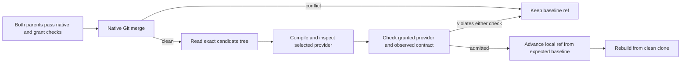

# Validate the selected native binding after a clean Git merge

Two branches can pass the same operation check and still compose a different executable binding. This study extends the native configuration-bound reverse-lookup comparison to actual two-parent Git merges, candidate verification, and ref publication in a temporary repository. It asks which parent receipts can be reused when the selected source, feature flag and grant inventory may change independently. [Configuration-bound caller coverage](RT-24-CONFIG-CALLER-COVERAGE-2026-11-25.md)

## Exact input and publication policies

A closed C wrapper calls `provider_base` while a feature is disabled. Enabling the feature selects a provider declared in a tracked header. The tracked grant file lists allowed providers. The fixture checks one behavior, returning the input plus one on eight admitted values. Valid alternatives include several implementations that produce the same values. Another provider adds two, and a restricted provider is absent from the grant even though its outputs agree. The compiler dependency list and the one x86-64 call relocation confirm which implementation is selected. A fresh native link and execution check all eight outcomes under both O0 and O2.

Each parent receipt records its exact tree, a scope derived from compiler inputs and their Git blobs, the selected flags, compiler tools, the eight inputs, the grant inventory and the claimed observation. All 18 parents are admitted before the candidate's status is checked. Five routes compare a native clean merge with accepted parents, reuse based on the selected provider name, reuse based on the whole tree, reuse of an exact scoped receipt, and fresh exact candidate validation. Scoped reuse treats ordinary notes as outside its input inventory. Fresh validation can also admit a new selection whose parent receipts cover different inputs.



The parent-based alternatives use only the native merge outcome and their own declared receipt keys when deciding whether to publish. The experiment still independently compiles every candidate as its comparator. Each proposed decision advances, or retains, a dedicated local Git ref. Every attempted replay using a stale expected ref is refused without changing the exact resulting branch. This local check does not exercise remote transport, distributed locking or durable receipt storage.

## Native results

Nine histories produce eight clean merges and one native header conflict. The experiment performs 36 parent builds, 16 candidate builds and 10 clean-clone rebuilds, with eight values per build. The valid fresh publications all have an exact clean-clone replay, including Git object integrity, input identity, call target and native outputs.

| Publication policy | Correct publications | Invalid publications | Valid candidates refused | Expected refusals |
|---|---:|---:|---:|---:|
| Clean Git and approved parents | 5 | 3 | 0 | 1 |
| Reuse by provider name | 4 | 1 | 1 | 3 |
| Reuse by exact Git tree | 1 | 0 | 4 | 4 |
| Reuse by exact build and grant scope | 4 | 0 | 1 | 4 |
| Fresh exact candidate check | 5 | 0 | 0 | 4 |

In one history, editing a dormant header and activating its feature yields a provider whose outputs differ. Another composition selects an ungranted provider whose outputs agree. In the third invalid composition, one parent enables an allowed provider while the other removes its grant with the feature dormant. The merged selection matches the first parent's provider, but its grant comes from the second. Provider-name reuse advances the ref in the third case because it ignores the changed grant context. The 23 advanced local refs all refuse stale CAS replay.

Exact tree reuse rejects every profile mismatch here and also refuses four valid candidates. A narrower receipt binds compiler inputs and grants, so it can survive the tested edits to ordinary notes. The scoped strategy still lacks a receipt for one valid new provider selection, which fresh validation supplies. Reusing a narrower receipt requires sufficient source, configuration and policy coverage for that candidate, with separate validation of any other required whole-tree obligations.

## Limits and replay

The test covers one selectable call in an explicitly complete fixture inventory. It leaves arbitrary source and dependency extraction, native platform coverage, proof and authorization issuer governance, concurrent changes, power-loss durability, production publication and independent review open. The sampled C observations do not establish a general arithmetic proof or a production compiler trust decision.

Use CPython 3.12.14, Debian GCC 14.2.0-19, GNU Binutils 2.44 and Git 2.52.0 on x86-64 Linux. The initial LLMLang base is `ad273585bab80b030e326186fbec401b14ecdaa6`. The ledger pins source and tool digests, exact commit and tree identities, candidate call selections, native observations, publication choices and clean-clone results.

```bash
fixture=research/toolchain-and-collaboration/RT-24/CONFIGURED-MERGE-PUBLICATION-01
PYTHONHASHSEED=1 python3 -B "$fixture/run.py" > /tmp/llmlang-configured-merge.json
cmp "$fixture/evidence.json" /tmp/llmlang-configured-merge.json
python3 "$fixture/chart.py"
```

[Native fixture](CONFIGURED-MERGE-PUBLICATION-01/run.py) · [Observation ledger](CONFIGURED-MERGE-PUBLICATION-01/evidence.json) · [Table generator](CONFIGURED-MERGE-PUBLICATION-01/chart.py)
