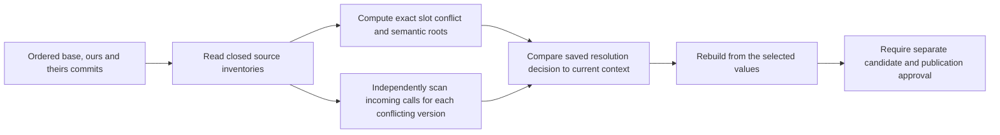

# RT-24 — Replay a conflict resolution against exact merge context

**Evidence** — Eight native Git contexts with exact typed declarations, preserved alternatives and independently rebuilt candidates.

## Question and scope

A merge tool may keep a reviewer's decision about one conflict while the source branches change. When can it still use that decision? A conflict summary can name the same three values after a change elsewhere creates a new affected caller. A semantic root can also stay unchanged after an ordinary file edit. We compare the reuse the toolchain gets from binding a decision to the local conflict, its affected caller scope, the three semantic roots, the three physical source inventories, or the three commit identities. [Semantic merge core](RT-24-CLOSED-THREE-WAY-MERGE.md) · [Candidate conflict policy](RT-24-CANONICAL-SEMANTIC-REPRESENTATION-DIFF-AND-MERGE.md#10-conflict-and-provenance-model)

The base selects the original provider, and ours and theirs select different replacements at one shared slot. The reviewed decision selects the ours value. The baseline ours tree also keeps the theirs value in a separate slot. That retention lets a later caller of the theirs value survive an exact fresh import. The decision record stores the conflict kind, slot, exact base/ours/theirs addresses, selected address and hashes for every context comparison. It preserves the input conflict and both alternatives for audit.



The scoped comparison independently checks incoming edges for the original provider and both alternatives in each input. It binds the resulting precise edge sets or observed target absence in the closed inventory. The three other contextual comparisons bind ordered roots, ordered tree and inventory IDs, or exact ordered commits and their inventories. A candidate is reconstructed from fresh rows after applying the resolved choice in the fixture. Reconstruction tests source closure. The experiment records a local decision with a fixed review policy and does not grant permission to publish it.

## Observations

| Changed context | Slot only | Scoped incoming edges | All semantic roots | All physical inputs | All ordered commits | Candidate rebuilt under the slot-only policy |
| --- | --- | --- | --- | --- | --- | --- |
| Reviewed inputs | Reuse | Reuse | Reuse | Reuse | Reuse | Closed |
| New empty commit, same tree | Reuse | Reuse | Reuse | Reuse | Reject | Closed |
| Ordinary-file edit | Reuse | Reuse | Reuse | Reject | Reject | Closed |
| New caller of theirs version | Reuse | Reject | Reject | Reject | Reject | Closed |
| New caller of an independent provider | Reuse | Reuse | Reject | Reject | Reject | Closed |
| Changed guard on the previously reviewed affected call | Reuse | Reject | Reject | Reject | Reject | Closed |
| New affected caller and removed retention | Reuse | Reject | Reject | Reject | Reject | Unclosed |
| Ours and theirs exchanged | Reject | Reject | Reject | Reject | Reject | No candidate |

The affected-caller control records a closed composition when the local resolution selects ours and the new caller still pins the retained theirs version. The same slot conflict and successful whole-graph closure therefore cannot establish that the review covered this caller. In the changed-guard control, the old review actually includes the earlier call. The new exact edge digest still rejects reuse. If the alternative was no longer retained, rebuilding also detects the missing exact target.

The unrelated-caller control separates a local scoped judgment from a whole-root decision. Both its scope and selected conflict values match, even though the newly composed snapshot differs. The ordinary-file and empty-commit controls distinguish semantic state, physical file state and commit lineage. An exact file-bound approval can survive a new commit with identical content only when its policy establishes that history does not affect that particular approval.

A release coordinator can preserve a previously checked local judgment only when the authority policy says which dependencies count and the current inputs establish that scope again. It must still recheck any changed repository, mapping or publication evidence. Production authorization, dynamic and generated callers, split/merge lineage, merge-parent proof, mapping conflicts and published commit recovery remain outside this fixture. [Exact-tree CIP and publication](RT-24-TREE-BOUND-CIP-PUBLICATION.md) · [Source query completeness](RT-24-MERGED-TREE-SOURCE-COMPLETENESS.md)

## Reproduction

Use Git 2.52.0 and CPython 3.12.14 from the repository root:

```sh
study=research/toolchain-and-collaboration/RT-24/CONFLICT-RESOLUTION-01
python3 -B "$study/run.py" --output /tmp/llmlang-conflict-resolution.json
cmp "$study/evidence.json" /tmp/llmlang-conflict-resolution.json
(cd research/PROTOTYPES/DEPENDENCY-GRAPH-01 && python3 -B -m unittest \
  tests.test_rt24_semantic_merge_core tests.test_rt24_typed_tree_diff \
  tests.test_rt24_tree_bound_cip tests.test_rt24_call_target_merge)
```

The [harness](CONFLICT-RESOLUTION-01/run.py) runs all eight contexts and checks the expected admission decisions. The [ledger](CONFLICT-RESOLUTION-01/evidence.json) records exact original alternatives, three input identities at each layer, affected-edge digests and the resulting rebuilt candidate or closure failure.
