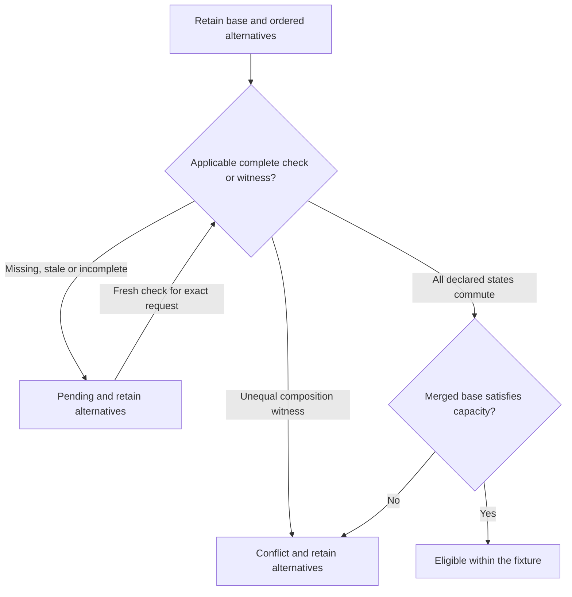

# RT-24 Conservative merge decisions with incomplete evidence

**Issue** [#321](https://github.com/aivibeflow/LLMLang/issues/321)

This finite model asks how a merge coordinator should handle a missing independence check, a bounded check that stops early, a check for a previous request, and a demonstrated conflict. LLMLang needs to carry both alternatives through review or retry while preventing an unchecked composition from becoming an automatically eligible candidate. The study builds on [independent edit checking](RT-24-INDEPENDENT-MERGE-GATE-2026-11-25.md) and [exact validation audit replay](RT-24-MERGE-VALIDATION-AUDIT-REPLAY-2026-11-25.md).

## Candidate decision procedure

An edit assigns one of two bit fields either a constant or the value of the other field. Edits commute on a state when composing them in either order produces equal states. This fixture's entire domain is the four possible bit pairs. It checks this domain in a fixed order up to a supplied case limit. A witnessed unequal pair is sufficient for a conflict. A prefix with equal results is pending until the remaining cases are checked. Once commutativity is established, the merged state from base `(0, 0)` must also satisfy the profile's upper bound on the sum of the fields.

A request binds the base, the exact alternatives in ours/theirs order, the scope, the capacity bound and the schema. A receipt binds the request digest, the checked cases and the outcome. The fixture trusts receipts it produced locally. Missing, incomplete and stale receipts retain the exact ordered alternatives in an unresolved record. A fresh retry uses those alternatives and may resolve the decision. A receipt for swapped alternatives or a different profile must be regenerated under this binding policy, even where the result can coincide.



The pending route covers operationally incomplete evidence and says nothing about validity. The conflict route carries either a concrete witness for order dependence or a violation of the merged invariant. Only eligibility includes a candidate ready for subsequent gates.

## Results and trade-offs

The [ledger](CONSERVATIVE-MERGE-01/evidence.json) records eleven initial decisions and fresh rechecks. All rechecks reproduce after a JSON round trip of the retained request. Exact states and results are recorded for each evaluated case.

| Initial condition | Cases | Decision |
| --- | ---: | --- |
| Missing, no states checked, or truncated prefix | 4 | Pending |
| Receipt with different alternative, reversed labels, or different capacity | 3 | Pending |
| Complete agreement and satisfied capacity | 2 | Eligible |
| Witnessed order dependence or failed postcheck | 2 | Conflict |

In the truncated invalid fixture, resetting the first bit and copying it to the second agree on the prefix containing `(0, 0)` and `(0, 1)`. At `(1, 0)`, their orders yield `(0, 0)` and `(0, 1)`. A freshness-only rule or a rule accepting partial agreement would therefore allow an order-dependent edit pair. The truncated valid fixture becomes eligible after checking all four states. This illustrates the cost of collapsing pending into permanent conflict. In the capacity case, each parent separately has sum 1, the two edits commute throughout the domain, and the merged state has sum 2. A separate capacity check detects the violation.

Finishing the finite check provides complete evidence for this scope. For a real SPG, broader proof methods may cheaply establish independence for adequately specified edit classes. Serializing unresolved alternatives supports explicit resolution without assuming that the future proof or resolution applies to a changed base or policy. This is a candidate workflow. The fixture models no real Git refs, graph extraction, receipt authentication, resolution UI, publication or persistent transaction. Its runtime is a deterministic evaluation of the finite domain, with no elapsed-time measurements.

## Reproduction

Use Git 2.52.0 and CPython 3.12.14 from the repository root. The runner verifies the reused canonical digest helper at `9fc1bde0127bd55aea65b58752d5af8c38390bf9`. Runs with hash seeds 1 and 2 produced byte-identical ledgers. Relative links and Mermaid source structure were checked locally. GitHub rendering was not manually verified.

```sh
study=research/toolchain-and-collaboration/RT-24/CONSERVATIVE-MERGE-01
PYTHONHASHSEED=1 python -B "$study/run.py" > /tmp/llmlang-conservative-merge.json
cmp "$study/evidence.json" /tmp/llmlang-conservative-merge.json
```
