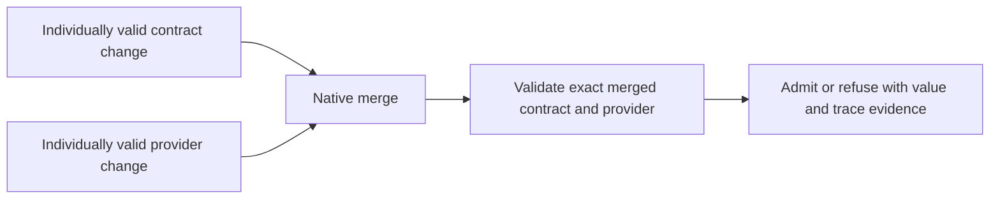

# RT-24 — Concurrent contract and implementation change

- **Date** — 2026-11-25
- **Tracking** — [PLAN §7.3](../../../PLAN.md#73-parallel-development-and-collaboration) · [#334](https://github.com/aivibeflow/LLMLang/issues/334)
- **Status** — Reproduced native merge and bounded contract revalidation

## Question and setup

When can a contract edit and an implementation edit be integrated independently? The initial contract permits an output between zero and the input and allows a modeled audit event after a read. The baseline C provider returns the input and the read event. Four independent contract branches strengthen the value rule, forbid audit, combine the restrictions, or widen the bound. Four independent provider branches return half the input, add the audit event, combine those two changes, or edit a comment. The provider encodes its modeled events in the returned observation word. [Public contracts and implementation refinement](../../semantic-representation/RT-05/PUBLIC-INTERFACES-AND-CONTRACT-REFINEMENT.md) · [Independent merge gate](RT-24-INDEPENDENT-MERGE-GATE-2026-11-25.md)

The runner checks the baseline and every parent at O0 and O2 for the complete fixture domain of 65 inputs. Git then combines each contract branch with each provider branch in both orders. The check reads the contract and C source from the exact merged tree and checks the native outputs and modeled trace against that contract.



## Results

All eight individual branches satisfy the contract in their own tree. The 32 native merges finish cleanly and produce the same tree in either orientation for every pair. The exact combined check admits nine pairs and refuses seven. The baseline, parents and combined checks account for 3,250 native observations across both optimization levels.

| Contract change | Half value | Identity with audit | Half with audit | Comment only |
|---|---|---|---|---|
| Exact identity output | Refused on value | Accepted | Refused on value | Accepted |
| Read event only | Accepted | Refused on trace | Refused on trace | Accepted |
| Exact output and read event only | Refused on value | Refused on trace | Refused on both | Accepted |
| Wider value range | Accepted | Accepted | Accepted | Accepted |

Half-value outputs violate the exact rule for 64 of 65 inputs. The unexpected audit event violates the read-only rule for all 65. A comment-only edit changes the source digest while preserving the native artifact and trace. Each merged result binds the exact contract and provider source, native artifacts and observation digest. Parent validation alone leaves the combined contract-provider relation unverified. [Evidence ledger](CONTRACT-BODY-MERGES-01/evidence.json)

## Limits

The fixture checks an explicit finite domain and modeled trace payloads. It does not cover external effect capture, contract implication over an unbounded domain, cross-operation dependencies, concurrent publication or proof-based evidence reuse. An implementation and contract can be edited separately. Their joint adoption still requires matching evidence for the selected pair.

## Reproduction

Run from the repository root with CPython 3.12.14, Git 2.56.1 and GCC 14.2.0 (Debian 14.2.0-19). The runner creates temporary native Git trees and compiles each exact provider source. [Runner](CONTRACT-BODY-MERGES-01/run.py)

```sh
set -eu
dir=research/toolchain-and-collaboration/RT-24/CONTRACT-BODY-MERGES-01
observed=$(mktemp)
trap 'rm -f "$observed"' EXIT
python3 -B "$dir/run.py" --cc gcc > "$observed"
cmp "$dir/evidence.json" "$observed"
```
