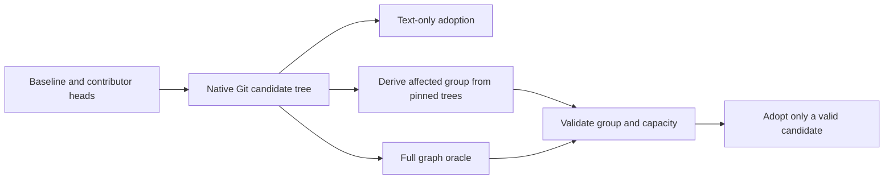

# RT-24 — Multi-contributor Git integration with scoped graph validation

- **Date** — 2026-11-25
- **Tracking** — [PLAN §7.3](../../../PLAN.md#73-parallel-development-and-collaboration) · [#334](https://github.com/aivibeflow/LLMLang/issues/334)
- **Status** — Reproduced in native temporary Git histories

## Question and method

Can a project accept many independently valid contributor changes while preserving a relational invariant across files? The fixture builds 48 commits from one baseline, one per synthetic contributor. There are 24 reservation groups with two separate files and a shared capacity of four. Each contribution edits one file. In 12 groups both changes individually fit and their combination exceeds capacity. In the remaining 12 groups the two changes fit together.

The experiment integrates the same contributions in six orders with native `git merge-tree`. The textual route takes each clean merge tree. The guarded route validates the candidate against the live head before accepting it. Its full check reads every group. Its scoped check derives the changed group from the pinned tree diff and reads both members and the capacity. The guarded route starts with a validated baseline and rechecks the resulting tree after every accepted step. [Independent merge gate](RT-24-INDEPENDENT-MERGE-GATE-2026-11-25.md) · [Semantic diff and merge model](RT-24-CANONICAL-SEMANTIC-REPRESENTATION-DIFF-AND-MERGE.md)



## Results

| Measure | Per integration order | Across six orders |
|---|---:|---:|
| Native merge calls across both routes | 96 | 576 |
| Clean text-only candidates | 48 | 288 |
| Scoped decisions matching the full graph oracle | 48 | 288 |
| Candidates accepted by guarded integration | 36 | 216 |
| Candidates refused for a capacity violation | 12 | 72 |
| Logical values read by full candidate validation | 2,352 | 14,112 |
| Logical values read by scoped candidate validation | 144 | 864 |

The text-only route reaches the same invalid tree in all six orders and leaves 12 invalid groups. The guarded route reaches six valid trees. Earlier accepted authors can differ, because they consume shared capacity in schedule order. A fresh clone reconstructs one selected guarded head and passes full validation. [Evidence ledger](CONTRIBUTOR-MERGES-01/evidence.json)

The affected-group check relies on a validated prior head and a complete dependency rule. A control starts from a head with an invalid unrelated group. Neither file in that group changes, so the scoped check admits the candidate while the full check correctly detects the existing violation. Logical values read describe the checked snapshots and do not measure physical filesystem or storage traffic.

## Limits

The fixture models 48 synthetic participants in closed, independent groups. A production graph needs complete affected-set derivation, a validated base, safe publication against concurrent head movement and reviewed ordering policy for conflicts. The comparison leaves real team workflows, cross-group dependencies, recovery under network failures and production scalability open.

## Reproduction

Run from the repository root with CPython 3.12.14 and Git 2.56.1. The runner creates and clones disposable local repositories, then compares exact tree identities and decisions. [Runner](CONTRIBUTOR-MERGES-01/run.py)

```sh
set -eu
dir=research/toolchain-and-collaboration/RT-24/CONTRIBUTOR-MERGES-01
observed=$(mktemp)
trap 'rm -f "$observed"' EXIT
python3 -B "$dir/run.py" > "$observed"
cmp "$dir/evidence.json" "$observed"
```
