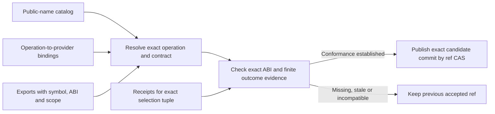

# Validate provider and export composition after Git merge

This RT-23/24 experiment compares merge and publication gates over three independent mapping domains. A public-name catalog resolves a name to an operation. A binding chooses its exact provider. An export selects a symbol, ABI profile and permitted input scope. Concurrent changes to separate files and different mapping keys can leave a selected combination with missing or invalid conformance evidence. [Interface mapping merge](../RT-23/RT-23-INTERFACE-MAPPING-MERGE.md) · [Exact mapping tree publication](../RT-23/RT-23-MAPPING-TREE-PUBLICATION.md)

## Model and gates

The fixture stores canonical immutable operation, contract and provider artifacts. All candidates use a shared integer signature and an explicit finite outcome table. The contract maps each permitted input to its successor. The two scopes contain three and five known inputs. ABI names are distinct scope labels whose support is declared by each provider. The fixture checks that support as metadata.

The gates compare native Git textual success, exact cross-map reference closure, receipt presence for the public contract, and checked evidence for the selected tuple. The tuple contains operation, contract, provider, ABI and input scope. The exact check reads each current artifact by immutable hash, compares the finite provider observations with the contract, and checks the exact receipt's vector digest. It distinguishes absent evidence from incompatible behavior and a malformed receipt. The proof does not bind an external symbol spelling when the operation, ABI and input scope stay fixed. Versioning the actual external name remains a separate mapping obligation.



Each temporary repository builds a base and two parents from disjoint edited paths. The fixture checks both parents independently against their own selected maps. A fresh import of the actual merged tree determines the required tuple. The publish control uses the exact candidate commit and the expected previous ref. The experiment does not write a repository outside its temporary directory.

## Results

Nine histories run on both native Git ref backends, giving 18 candidates. Both backends produce equal observed objects, decisions and ref outcomes. The authored expected disposition for every case is checked against the fresh import. All textual merges complete cleanly and all 36 parent checks succeed. Reference closure and the contract-level receipt gate each accept 16 candidates. The exact gate advances the accepted ref in six cases and keeps its old value in 12.

| Merge case | Contract-only accepts | Exact gate publishes | Disposition |
|---|---:|---:|---|
| Unchanged operation and renamed symbol | 2/2 | 2/2 | admitted |
| New ABI with no selected provider receipt | 2/2 | 0/2 | unknown receipt |
| New ABI with exact crossed receipt | 2/2 | 2/2 | admitted |
| Selected provider lacks ABI support | 2/2 | 0/2 | abi mismatch |
| Wider scope with no selected provider receipt | 2/2 | 0/2 | unknown receipt |
| Selected behavior fails wider scope | 2/2 | 0/2 | behavior mismatch |
| Exact claim key with stale check bytes | 2/2 | 0/2 | invalid receipt |
| Export activated and its binding deleted | 0/2 | 0/2 | missing binding |
| Public name alias resolves to same operation | 2/2 | 2/2 | admitted |

The new-ABI case demonstrates three distinct results. The reference can exist and the provider can support the ABI while the current tuple lacks evidence. An exact receipt supplied by the other branch lets the same combined selection pass. A provider with no declared support is rejected as incompatible. The wider input scope can similarly expose missing evidence or a concrete fixture behavior mismatch. Stale check bytes fail even when the receipt carries the current key. The dormant binding case has clean files and individually valid parents, but resolving the combined new export fails because its binding was removed.

## Limits and replay

The comparison covers one fixed finite contract and one namespace, with authenticated receipt issuance out of scope. The test digest checks exact fixture data. It does not verify a general proof language, actual machine-level ABI compatibility, deployed namespace authority, an arbitrary catalog translation, or race durability beyond the tested ref update. Production proof governance, foreign interface semantics, same-key policy and independent review remain open. The result separates native file merge, graph closure and compatibility checks required at the concrete selected export.

Use Git 2.52.0 and CPython 3.12.14. The initial LLMLang baseline is `7f403a84c95e609a1fd90fe6826c4448adeebd8d`. The ledger records exact Git objects, changed paths, selection tuples, candidate dispositions and the fixture SHA-256. Replay from the checkout root.

```bash
fixture=research/toolchain-and-collaboration/RT-24/CROSS-MAP-EXPORT-01
PYTHONHASHSEED=1 python3 -B "$fixture/run.py" > /tmp/llmlang-rt24-cross-map.json
cmp "$fixture/evidence.json" /tmp/llmlang-rt24-cross-map.json
python3 "$fixture/chart.py"
```

See the [native merge runner](CROSS-MAP-EXPORT-01/run.py), [measured ledger](CROSS-MAP-EXPORT-01/evidence.json), [table generator](CROSS-MAP-EXPORT-01/chart.py), and [RT-05 public-interface design](../../semantic-representation/RT-05/PUBLIC-INTERFACES-AND-CONTRACT-REFINEMENT.md).
