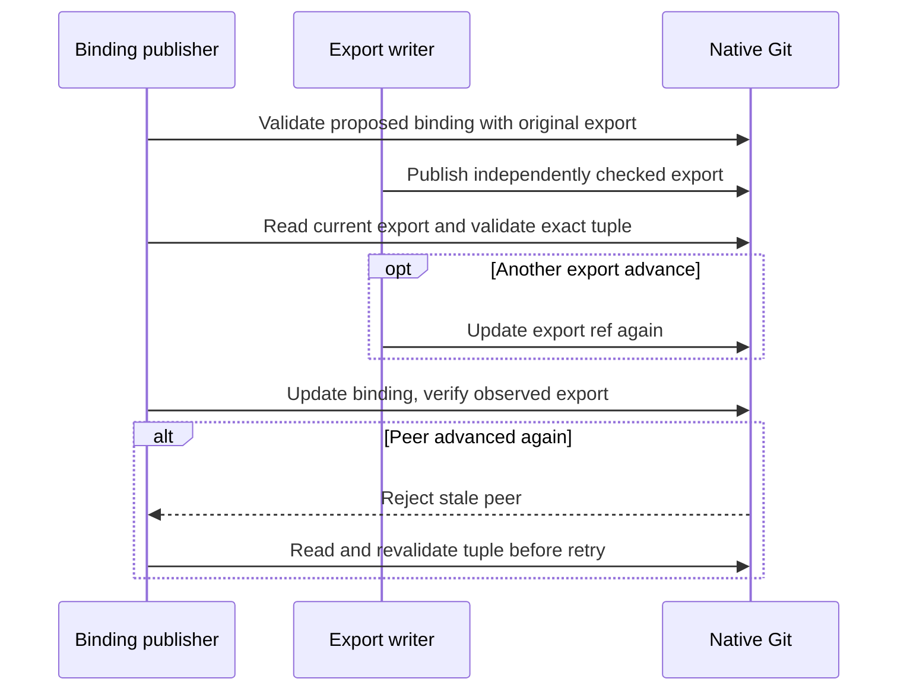

# Revalidate dependent export refs before publishing a binding change

This RT-23/24 experiment checks publication strategies when a binding and its external export live under separately mutable Git refs. Both writers can propose a valid selection with the same starting state. The final composition can still be incompatible, lack exact evidence, or preserve a valid proposal despite unrelated ref advancement. The experiment compares an original co-observation, a fresh composition check and expected-ref conditions in a native Git transaction. [Exact export tuple](RT-24-CROSS-MAP-EXPORT-PROOF-2026-11-25.md) · [Native dependent ref verification](../RT-23/RT-23-DEPENDENT-REF-VERIFICATION-2026-11-24.md)

## Model and event schedule

The binding ref selects the exact provider and its local receipts. The export ref selects public names, the external symbol, a fixture ABI label and a finite input scope. The earlier cross-map fixture supplies canonical operation, contract and provider artifacts and an exact receipt checker. At preparation the binding publisher validates its proposal paired with the original export ref. A separate writer then publishes its own valid export against the original binding.

Six schedules change relevant format or evidence, add an unrelated export, or temporarily withdraw and then restore the same export blob at new ref values. One schedule also makes a second export update after the publisher's fresh validation and before the native binding transaction. Each step uses a real compare-and-set in a disposable repository. The scripted interleaving fixes the order without a throughput or timing claim.



The strategies differ in their freshness condition. Own-ref CAS relies on the initial decision. Strict refs check both originally observed OIDs and stop on staleness. Fresh unverified rechecks once before writing with only own-ref CAS. Fresh verified checks the latest exact tuple and verifies its observed export OID in the same `update-ref --stdin` transaction. If the peer advanced again, it reads and checks the replacement before retrying. The test bounds that retry to the demonstrated interleaving.

## Results

Six schedules cross two ref backends and four policies, yielding 48 cases. Each policy has 12 trials. A valid proposed change pairs with the final export and has checked exact evidence. An ineligible publication advances the binding despite incompatible or unknown evidence in the resulting pair.

| Publication policy | Accepted changes | Ineligible publications | Valid changes refused |
|---|---:|---:|---:|
| Old decision and own-ref CAS | 12 | 6 | 0 |
| Verify both originally observed refs | 0 | 0 | 6 |
| Recheck current peer and verify only own ref | 8 | 2 | 0 |
| Recheck current peer and verify both refs | 6 | 0 | 0 |

The own-ref gate admits six ineligible proposals. Verifying the original peer avoids them and refuses six valid changes. Fresh checking alone handles a changed first peer but admits two additional races when the peer moves again after the check. Fresh checking plus a verified ref keeps all six valid publications and excludes all six ineligible cases. In the second-move controls, the native transaction rejects the stale peer OID and the next check observes an incompatible ABI before any binding write.

A restored export uses the same blob after an observed withdrawal and a changed Git OID. Fresh checked publication can admit it under this fixture's value-scoped receipt policy. A continuity or consent policy would need historical authorization evidence as an additional input.

## Limits and replay

The experiment uses a finite exact tuple and a cooperative local publication path. ABI compatibility uses the earlier fixture labels. Native Git verifies the supplied expected values, with higher-level evidence coverage and policy left to the publication service. The scope includes explicit interleavings but leaves arbitrary contention, rollback to an identical ref OID, authorization, crash recovery, production foreign ABI validation and independent review open.

Use CPython 3.12.14 and Git 2.52.0. The initial LLMLang base is `10adb81272bf7ca513fc551b7da6d7b6e87bf1c0`. The ledger pins the previous fixture source and records exact Git objects, checked tuples, native commands and same-content withdrawal and restoration. Run from the repository root.

```bash
fixture=research/toolchain-and-collaboration/RT-24/CROSS-MAP-REFS-01
PYTHONHASHSEED=1 python3 -B "$fixture/run.py" > /tmp/llmlang-rt24-cross-map-refs.json
cmp "$fixture/evidence.json" /tmp/llmlang-rt24-cross-map-refs.json
python3 "$fixture/chart.py"
```

See the [native schedule and runner](CROSS-MAP-REFS-01/run.py), [measured ledger](CROSS-MAP-REFS-01/evidence.json), [table generator](CROSS-MAP-REFS-01/chart.py), and [interface mapping model](../RT-23/RT-23-INTERFACE-MAPPING-MERGE.md).
