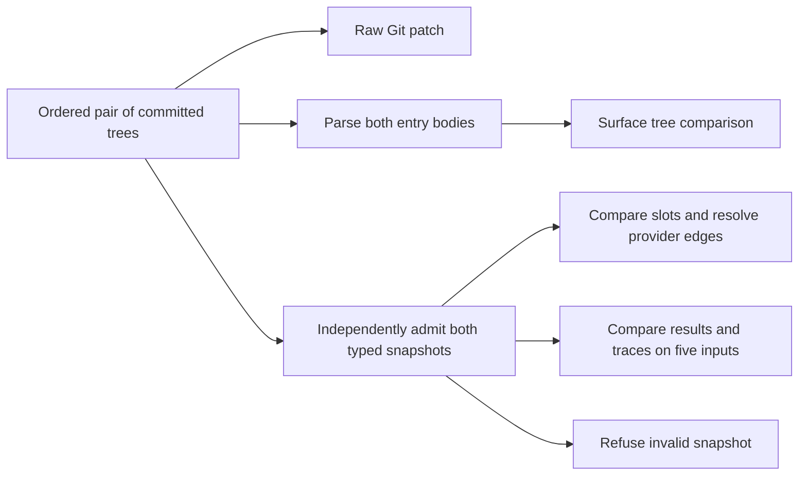

# RT-24 Source, surface, graph and observation changes

**Issue** [#321](https://github.com/aivibeflow/LLMLang/issues/321)

A reviewer can compare Git bytes, the parsed body of an implementation, or the typed snapshot that selects exact providers. Each view answers a different question. This study pins the same two committed inputs for all views and checks the differences against finite interpreter observations. The scope is the [typed SPG prototype](../../PROTOTYPES/DEPENDENCY-GRAPH-01/src/spg_representation.py) with two expression surfaces, one operation binding and one entry.

## Comparison procedure

The raw patch includes all committed changes. The surface comparison uses the entry's abstract syntax tree (AST) without positions for infix, or its parsed list tree for prefix, together with the grammar tag. It makes no cross-grammar correspondence assumptions. The typed graph comparison admits both complete fixture programs with the existing prototype. A typed snapshot is a table selecting exact graph addresses by declared slot. The comparison reports changed slot addresses and the old and new exact provider selected through the binding edge. In the fixture all slot names are fixed. The root is a digest of those selections. A comparison refuses an invalid input before producing typed deltas.

The observation comparison evaluates the admitted entry on the same five integer inputs and records results with event traces. It is a bounded behavioral check. Equal observations cannot establish behavior equivalence over unrestricted programs or identify a structural change. A deeper source-only tool could include bindings in a project-level syntax tree, at the cost of modeling relationships across declarations. It would still need typed resolution to derive the exact provider address. [Typed tree diff with exact edge selectors](RT-24-TYPED-TREE-DIFF.md)



All comparisons start with the same committed revision pair. The typed path requires successful independent admission of both sides. Its outputs expose selection changes even when the entry body has no syntax changes.

## Results

The runner creates one baseline, seven valid comparisons and one rejected variant. The [ledger](DIFF-OBSERVATION-LAYERS-01/evidence.json) preserves the exact raw patches, parsed bodies, typed addresses, slots and observations. It includes 40 result-and-trace observations across the eight admitted revisions. The table summarizes the discrete comparisons without reporting time or resource measurements.

| Candidate relative to baseline | Raw patch | Entry surface tree | Typed graph | Five observations |
| --- | --- | --- | --- | --- |
| Same bytes with new commit | Equal | Equal | Equal | Equal |
| Documentation change | Changed | Equal | Equal | Equal |
| JSON formatting and redundant parentheses | Changed | Equal | Equal | Equal |
| Same call written in prefix form | Changed | Changed | Equal | Equal |
| Operation binding selects subtraction | Changed | Equal | Binding changes | Changed |
| Explicit addition of zero | Changed | Changed | Entry value changes | Equal |
| Explicit addition of one | Changed | Changed | Entry value changes | Changed |
| Binding names absent implementation | Changed | Same body in source | Admission refused | Unavailable |

The prefix and infix calls normalize to identical typed graph selections. Changing the binding leaves the entry implementation address unchanged while selecting the exact subtraction provider. On inputs −2 through 2 its outputs are `[-3, -2, -1, 0, 1]`, compared with the baseline `[-1, 0, 1, 2, 3]`. Adding zero keeps those baseline observations and changes the graph because the fixture retains the additional expression. The invalid input gives an explicit admission error and no typed diff result. These controls motivate retaining the byte patch, typed graph delta and observation evidence as separately attributed views of one exact revision pair.

This candidate definition is scoped to declared slots, one typed operation binding, and the prototype's small expression profile. It makes no decision about canonical SPG equivalence, expression normalization, cross-slot lineage, external dependencies, proof obligations or general behavioral equivalence. A production diff still needs complete source and selection admission and precise rules for matching occurrences across snapshots.

## Reproduction

Run from repository root with Git 2.52.0 and CPython 3.12.14. The runner verifies its Git helper and prototype modules at `321d7a0c00db0e9fbaa2b3ea24c436b882c76cb0`. Seeds 1 and 2 produced byte-identical ledgers. Local links and Mermaid source structure were checked. GitHub rendering was not manually verified.

```sh
study=research/toolchain-and-collaboration/RT-24/DIFF-OBSERVATION-LAYERS-01
PYTHONHASHSEED=1 python -B "$study/run.py" > /tmp/llmlang-diff-layers.json
cmp "$study/evidence.json" /tmp/llmlang-diff-layers.json
```
