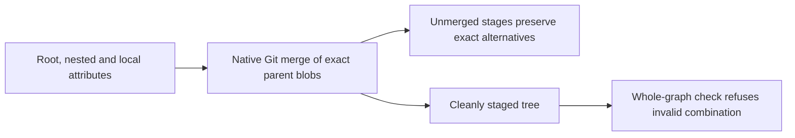

# RT-24 — Effective merge attributes and unresolved semantic conflicts

Can a repository's tracked binary fallback preserve semantic conflict stages when a path uses different attributes? Five disposable Git histories exercise the same overlapping semantic update under different attribute sources. The branch baseline is `1aae659899c4ebd392bc955d52b343aa2894e4c8`. [Native fallback comparison](RT-24-MERGE-FALLBACK-ADMISSION-2026-11-25.md)

Each branch changes a different line of one semantic record from 0 to 1. The rule requires their sum to be at most 1. The two branch tips each pass. The fixture names a root-level binary rule with `-merge`, checks effective attributes in the worktree, index and selected HEAD view, and invokes native Git merge with `--no-commit --no-ff`. It verifies exact base and parent blob IDs when unmerged stages are present. When the index has a candidate tree, it validates the staged bytes.



| Attribute sources | Worktree query | Index query | HEAD-source query | Merge result |
|---|---|---|---|---|
| Tracked root binary rule | unset | unset | unset | Stages 1, 2 and 3 |
| Tracked nested text rule | text | text | text | Clean index, sum 2 |
| Local `.git/info/attributes` text rule | text | text | text | Clean index, sum 2 |
| Local binary rule over tracked nested text | unset | unset | unset | Stages 1, 2 and 3 |
| Untracked nested text rule in worktree | text | unset | unset | Clean index, sum 2 |

In the table, Git's `unset` value selects the built-in binary policy for the merge attribute. The root-only case and both local text override cases share identical base and parent commits. A working-tree query detected the untracked override where `--cached` and `--source=HEAD` retained the tracked answer. The local `info/attributes` override affected all three queries, including the HEAD-source query. [Exact case receipts](MERGE-ATTRIBUTE-SCOPE-01/evidence.json)

All five attempts preserved the original HEAD. Two preserved conflict stages, and the whole-graph check rejected the three clean candidates. This bounds what attribute inspection can establish in a checkout. The actual effective rule and the selected commit's tracked rule can differ, and an exact candidate still needs its whole-graph check. This experiment covers one path on one native Git/Linux profile. Other Git operations, external drivers and the production acceptance gate remain open. [Repository setup and team workflow](RT-24-TEAM-GIT-WORKFLOW-2026-11-25.md) · [Git integration issue](https://github.com/aivibeflow/LLMLang/issues/322)

## Reproduction

Git 2.56.1 and CPython 3.12.14 produced the same receipt under hash seeds 1 and 2. The runner reuses the pinned fallback harness's Git environment and same-file line spacing. The diagram was checked as Mermaid source.

```bash
fixture=research/toolchain-and-collaboration/RT-24/MERGE-ATTRIBUTE-SCOPE-01
LC_ALL=C PYTHONHASHSEED=1 python3 -B "$fixture/run.py" > /tmp/llmlang-rt24-merge-attribute.json
cmp "$fixture/evidence.json" /tmp/llmlang-rt24-merge-attribute.json
```
