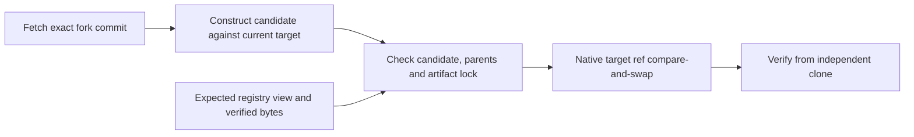

# RT-24 handoff from a Git fork and an artifact registry

A fork contribution can retain exact source identity while its intended target branch advances. A fresh candidate must bind the current target head, the fork namespace and commit, the exact merged result, and the registry generation and artifact identity required by that result.

## Candidate handoff

| Subject | Checked boundary |
| --- | --- |
| Source | Approved fork namespace and the fetched immutable commit |
| Target | Current target ref and exact expected previous commit |
| Candidate | Checked commit with ordered target and fork parents, and exact artifact lock in its tree |
| Registry | Expected registry identity and generation, scoped permission and bytes matching the declared artifact digest |
| Publication | Compare-and-swap the target ref against the expected head, then reconstruct the integrated result from a clean clone |



The replay uses temporary Git SHA-256 repositories and a modeled registry with two scoped inventories. The initial fork descends from the common base. While the fork artifact selection stays fixed, the upstream policy changes and changes the merge candidate. The target head and original reviewed candidate remain available as exact identities. The new candidate includes the current upstream policy.

## Results

One of nine main handoffs is eligible. The other eight refuse stale review, wrong fork namespace despite the same incoming commit, wrong candidate, another registry with the same bytes, wrong registry generation, absent permission, absent exact payload or bytes with the wrong digest. Neither the fork's existing commit nor equal object bytes imply approval for a different source or registry.

Two additional controls refuse a candidate with the old target parent and a native ref compare-and-swap with a stale expected head. The exact handoff updates the fixture's target ref once. A fresh non-local clone reproduces the integrated commit, ordered parents and artifact lock. The fixture uses configured synthetic authority and local transport. Distributed registry reads, authenticated repository identities and cross-service publication coordination remain open. [Scoped artifact registries](../../packages-and-ecosystem/RT-12/RT-12-SHARED-STORE-AND-SCOPED-REGISTRY-2026-11-25.md) · [Signed audit trail](RT-24-SIGNED-AUDIT-CHAIN-2026-11-25.md)

## Reproduce

Use Git 2.56.1 and CPython 3.12.14. Hash seeds 37 and 71 reproduce evidence SHA-256 `a3797ff4a708ded799449d2deeba45973d279dfd7b80af2dc63f216dce4ae27a`. [Evidence ledger](FORK-REGISTRY-HANDOFF-01/evidence.json)

```sh
LC_ALL=C PYTHONHASHSEED=37 PYTHONDONTWRITEBYTECODE=1 \
  python research/toolchain-and-collaboration/RT-24/FORK-REGISTRY-HANDOFF-01/check.py > /tmp/rt24-fork-handoff.json
```
