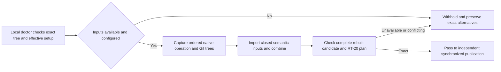

# RT-24 repository-level merge coordinator and local setup verification

A per-path Git merge driver can report its local result without knowing the complete program. The repository coordinator needs exact base, ordered parents, selected Git trees, and current source and validation policy. This study specifies the coordinator protocol and tests a read-only local setup check over real Git configuration and attributes. Existing repository experiments test the native operations and interactive adapter.

## Coordinator scope

Prepare in a disposable worktree or staged candidate area. Resolve the operation as a merge, bounded rebase or cherry-pick with explicit upstream and replay roles. Pin exact selected commits and trees, and validate the ancestry expected by the operation. Recover the complete textual inventory and exact dependencies. Import each typed graph, apply the pure merge and rebuild the resulting source and semantic selection. Ordinary Git can produce a candidate tree. Compare its ordered parents and complete typed delta independently, including exact caller migration or plan requirements. For a multi-step replay check every retained prefix.

The merge driver handles a supported path representation. It can emit an unresolved result or exact alternative stages. A mergetool presents both alternatives and can submit an exact scoped resolution. Its exit status cannot replace whole-tree validation or authorize a Git ref update. Use a narrow local setup profile with explicitly registered tools and effective attributes. If the coordinator or required exact context is unavailable, keep the candidate withheld. A conservative file-level fallback preserves true path conflicts. The complete tree gate still runs even when no unmerged entries remain.



## Read-only doctor

The fixture checks that the expected tree is the selected tree, Git's pinned-source and effective merge attributes resolve to the configured semantic driver, and the local driver and mergetool settings match the declared profile. It refuses a profile that treats the mergetool exit code as sufficient. It also tests the missing coordinator disposition. The prototype receives availability as an explicit input. It neither executes the configured programs nor attests their binaries. A production doctor must verify independently approved tool identities and the exact profiles it will invoke.

Git's pinned-source attribute query can still observe local info attributes. Checking that query alone cannot establish that the committed policy is the intended one when local mechanisms can override it. Consult the exact tracked attribute files as the policy source when setup is authority-bearing, and compare effective settings before candidate preparation. The fixture tests rejection of local or untracked changes that deviate from the expected effective attribute.

| Doctor disposition | Cases across SHA-1 and SHA-256 |
|---|---:|
| Ready for an exact candidate check | 2 |
| Effective attribute scope differs | 4 |
| Local driver or mergetool configuration differs | 6 |
| Coordinator availability missing | 2 |
| Exact tree absent or mismatched | 4 |

All 18 controls agree with the disposition table. Each call preserves the selected commit and working file. A successful setup result only authorizes attempting the separate exact candidate check.

The [exact-tree coordinator](RT-24-GIT-CORE-COORDINATOR-2026-11-25.md) checks 24 real merge, rebase and cherry-pick cases and three text conflict comparisons. It detects stale refs, incomplete source and graph conflicts before publication in the closed fixture. The [native driver](RT-24-NATIVE-GIT-MERGE-DRIVER-2026-11-24.md) demonstrates identical path input with different whole-graph outcomes. The [mergetool](RT-24-NATIVE-GIT-MERGETOOL-2026-11-24.md) retains exact stages on failed or unsupported resolution. The [replay-prefix study](RT-24-MULTI-COMMIT-REPLAY-PREFIXES-2026-11-24.md) checks nine candidates with one terminal tree and demonstrates failures hidden by examining only the tip.

## Verify and limits

The [runner](GIT-COORDINATOR-DOCTOR-01/check.py) and [ledger](GIT-COORDINATOR-DOCTOR-01/evidence.json) use native Git 2.56.1 and CPython 3.12.14. The claim baseline is `79b1a1c4c40c623a3b41ad4147eb448684255873`. Both hash seeds give identical outcomes.

```bash
fixture=research/toolchain-and-collaboration/RT-24/GIT-COORDINATOR-DOCTOR-01
LC_ALL=C PYTHONHASHSEED=37 python3 -B "$fixture/check.py" > /tmp/llmlang-git-coordinator-doctor.json
cmp "$fixture/evidence.json" /tmp/llmlang-git-coordinator-doctor.json
```

The fixture tests a Linux setup profile in temporary native repositories. It supplies no production executable registration, independently governed activation, or remote merge authority. Those depend on approved profiles and the synchronized publication protocol.
