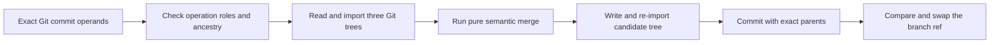

# RT-24. Exact-tree Git coordination after structural merge

This experiment connects the pure semantic merge core to native Git with explicit base, ours and theirs commit IDs. It covers three operations in disposable repositories. The coordinator verifies commit identities and ancestry, imports each exact tree independently and runs the pure merge before creating a commit. [Issue #321](https://github.com/aivibeflow/LLMLang/issues/321) · [Pure three-way core](RT-24-PURE-MERGE-CORE-2026-11-25.md)

| Operation | Input and output roles |
| --- | --- |
| Merge | The supplied base must be the single native merge base. Ours is expected at the checked ref. The new commit has ours and theirs as parents. |
| Single-step rebase | The replayed commit is expected at the ref, with the named base as its sole old parent. The new commit has the named upstream as its only parent. |
| Cherry-pick | The selected commit has the named base as its sole parent. The target head is expected at the checked ref and becomes the new commit's parent. |

All three operations import the complete manifest-declared fixture tree. The coordinator rebuilds a canonical candidate tree, independently re-imports it, compares exact selections and updates the ref only if its expected commit still matches. It leaves the live index and uncommitted worktree bytes untouched throughout the fixture.



## Results

All three coordinator operations publish the independent edits after re-import verifies their combined tree. Native Git merge, rebase and cherry-pick each report a textual conflict on the same one-line fixture file for those inputs. The semantic coordinator applies its closed policy across the whole declared graph. [Native observations and commit identities](GIT-CORE-COORDINATOR-01/evidence.json)

The 24 coordinator cases include seven controls per operation. Same-slot updates and missing selected dependencies yield semantic conflicts. An incomplete manifest, a tracked file outside the supported profile, a wrong base and an absent commit are refused before ref update. When another writer updates the branch after candidate validation, native compare-and-swap preserves that intervening commit. A dirty worktree remains byte-identical even in a successful case.

This is a structural coordinator for closed source fixtures. It explicitly refuses trees outside that fixture layout. Real source authority, exact CIP obligations and approvals, multiple rebase steps, merge-base ambiguity handling beyond refusal, worktree reconciliation, repeat receipts, crash recovery and production Git hooks remain open.

## Replay

Source baseline `08d5eaa` on `research/all`. Replay used Git 2.56.1, SHA-1 test repositories and CPython 3.12.14 on Linux. All disposable repositories use branch `research/all`. Run from the repository root.

```sh
data=research/toolchain-and-collaboration/RT-24/GIT-CORE-COORDINATOR-01
receipt=$(mktemp)
python -B "$data/run.py" "$receipt"
cmp "$data/evidence.json" "$receipt"
rm "$receipt"
```
