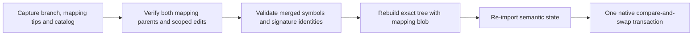

# RT-24. Coordinate a separately versioned interface mapping with Git

Interface mapping revisions are mutable selections over immutable semantic state. This experiment combines the existing RT-23 mapping merge and canonical export with a native Git ref transaction. The mapping capture binds the current branch, current mapping revision, incoming mapping revision and exact catalog. The pinned common mapping parent is reconstructed independently from its stored revision. [Issue #321](https://github.com/aivibeflow/LLMLang/issues/321) · [Interface mapping merge](../RT-23/RT-23-INTERFACE-MAPPING-MERGE.md) · [Mapping export](../RT-23/RT-23-MAPPING-TREE-PUBLICATION.md)

The merge requires both tips to reconstruct from their recorded edits and exact parent. It checks namespace, exported symbol and signature against the catalog and preserves distinct namespaces. The exported mapping becomes one exact blob in the candidate tree. Re-import verifies that the semantic root and ordinary tracked files retain their identities. Native Git verifies the incoming and catalog refs while updating the branch and current mapping ref together.



## Results

A disjoint edit in the `api` namespace and an addition in the `cli` namespace publish together. Both namespaces bind the same symbol spelling under their own signatures. The mapping revision changes, while the semantic Snapshot and ordinary review blob keep their identities. A clean native clone reconstructs both the semantic state and the selected mapping artifact. [Native ref and tree ledger](GIT-MAPPING-COORDINATION-01/evidence.json)

Eleven controls refuse a same-key equal edit, a same-key divergent edit, a deletion against an update, a namespace export collision, a wrong signature, a wrong parent, a mismatched semantic catalog and four stale native refs. One stale mapping control restores the same logical entries through different revisions. Another keeps the exact signatures and changes the semantic root. Neither reaches publication. No rejected transaction changes a ref outside the intentional fixture race.

The catalog is a trusted fixture input. The experiment covers two direct mapping parents, exact bound signatures and native ref updates. Semantic compatibility of real ABI implementations, authority for catalog issuance, arbitrary mapping ancestry, durable event receipts and distributed publication remain open.

## Replay

Source baseline `d5bda28` on `research/all`. Replay used Git 2.56.1, SHA-1 fixtures and CPython 3.12.14 on Linux. Each temporary Git repository uses branch `research/all`. Run from the repository root.

```sh
data=research/toolchain-and-collaboration/RT-24/GIT-MAPPING-COORDINATION-01
receipt=$(mktemp)
python -B "$data/run.py" "$receipt"
cmp "$data/evidence.json" "$receipt"
rm "$receipt"
```
