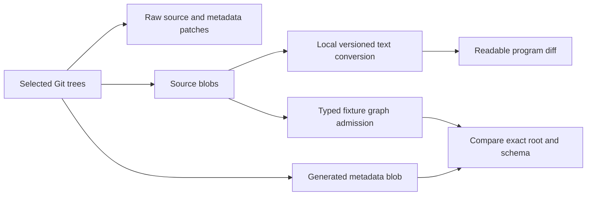

# RT-24 Git patches and readable program review

**Issue** [#320](https://github.com/aivibeflow/LLMLang/issues/320)
**Evidence** Bounded Git integration experiment with a candidate text projection.

LLMLang needs a readable view of a committed program change while preserving exact physical patches and keeping generated metadata verifiable. This experiment compares raw Git diffs with a versioned local renderer over the closed JSON declaration from the [snapshot mapping study](RT-24-COMMIT-TREE-SEMANTIC-ROOT-MAPPING-2026-11-25.md). It asks which changes each view exposes and what a clean clone needs to reproduce the view.

## Candidate separation

The tracked JSON program declares the entry expression and the selected provider for the compute operation. The tracked generated file, `review.json`, records the rendered schema version and the expected typed program root. The converter displays the schema header, provider and quoted entry expression in fixed order. Git's `textconv` interface supplies the contents of each source blob to this local converter before line comparison. The tracked attribute selects the driver by name. The clone needs an explicitly installed converter command in its local Git configuration. This experiment disables conversion caching.

The raw program patch exposes all source byte edits, including representation noise. The converter makes a provider replacement explicit and suppresses key reorder and indentation churn. An independent check rebuilds the typed root and compares the exact generated metadata bytes. A richer typed diff can explain call sites, lineage, and dependencies across files, with additional whole-snapshot admission costs. [Typed tree diff](RT-24-TYPED-TREE-DIFF.md)



The diagram shows three uses of the same committed bytes. The converter is a per-file reviewer aid. An empty rendered program diff leaves the metadata comparison and any other file changes to their respective checks.

## Native Git observations

The runner creates six commits and uses five independent full local clones, one per candidate. The attributes in the candidate checkout control driver selection in this fixture. Each comparison uses the same immutable base and candidate commits. The control without converter registration yields the raw patch in every clone. The typed graph is reconstructed independently of the converter and evaluated on inputs −1, 0 and 1.

| Candidate relative to base | Raw source patch | Configured program view | Raw metadata patch | Typed values | Metadata check |
| --- | --- | --- | --- | --- | --- |
| Indentation and key reorder | Present | Empty | Empty | `[0, 1, 2]` | Matches |
| Provider changed and metadata regenerated | Present | Shows plus to minus | Present | `[-2, -1, 0]` | Matches |
| Provider changed and metadata retained | Present | Shows plus to minus | Empty | `[-2, -1, 0]` | Refused |
| Only metadata changed to the other root | Empty | Empty | Present | `[0, 1, 2]` | Refused |
| Format edit and driver attribute removed | Present | Falls back to raw | Empty | `[0, 1, 2]` | Matches |

The two provider cases have the same typed root and readable patch, yet the metadata check differs. The metadata-only case can leave both program views empty while carrying an incorrect typed root. The missing-attribute control shows that local registration alone does not enable conversion. A reproducible review workflow should identify the view and converter version used, and run the metadata check from the selected tree. No elapsed time or size was measured. The table and the [ledger of exact diff outputs](GIT-REVIEW-PROJECTION-01/evidence.json) preserve the discrete results.

## Reproduce and interpret

From repository root, run with Git 2.52.0 and CPython 3.12.14. The runner checks the imported source modules against `b42d1b0b8fd1332a49a0ee91c0ff7b19e7b6ac63`. Seeds 1 and 2 produced byte-identical ledgers. Relative links and the Mermaid block structure were checked locally. GitHub visual rendering was not manually verified.

```sh
study=research/toolchain-and-collaboration/RT-24/GIT-REVIEW-PROJECTION-01
PYTHONHASHSEED=1 python -B "$study/run.py" > /tmp/llmlang-git-review.json
cmp "$study/evidence.json" /tmp/llmlang-git-review.json
```

The fixture admission reconstructs only the declared program in the selected tree, using its two-provider grammar. The generated metadata provides a root consistency assertion for this profile. It carries no signature or producer identity. General SPG schema coverage, external dependencies, duplicate declaration member policies, Git hosting support, conversion caching, patch applicability and merge admission remain outside the experiment. Production work must choose a canonical representation and define which generated fields can be recovered and independently checked.
