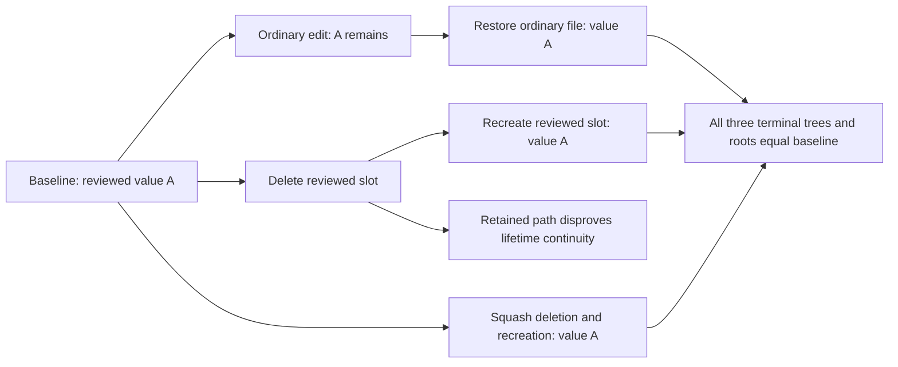

# RT-24 — Selection lifetime across equal Git trees

**Evidence** — Twelve native Git cases with the existing closed-inventory importer.

**Scope** — Two independent slots in one repository, one reviewed declaration, and one deliberately linear continuity policy.

## Question and policies

A selected value can be immutable and shared while each selection has its own lifetime. A proof of a property of the exact value can be reused when its full verification inputs match. A review that grants permission to modify a managed occurrence can instead depend on that occurrence having survived continuously. RT-05 already demonstrated that equal fixture states cannot distinguish survival and recreation. Here the question is whether the actual persisted Git history supplies enough additional evidence. [RT-05 lifecycle experiment](../../semantic-representation/RT-05/RT-05-IDENTITY-LIFECYCLE-EXPERIMENT.md)

The fixture distinguishes three comparisons. A tree match compares bytes and file modes committed through Git. A semantic root match compares the full imported fixture state while ignoring ordinary files. A selection value match compares the exact digest at the reviewed slot. A fourth check walks raw Git parent references from the candidate to the baseline, imports every retained program inventory into a fresh store and requires the reviewed slot to be present throughout. It returns unknown when it cannot establish a closed linear path. Its receipt binds the slot, ordered commits, trees, imported roots and selected values. Ordinary edits and changes to other slots may occur along that path. The slot policy requires equal endpoint values and observed continuity. The value-only column assumes all other immutable proof inputs are fixed and does not exercise a proof checker.



The two-step recreation and its squash differ in the retained ancestry. The deleted selection is observable only in the two-step path. This matters to clean-clone reconstruction because neither program blobs nor an existing local cache can supply an omitted event.

## Observations

| Candidate | Equal tree | Equal root | Equal selected value | Reviewed slot history | Reuse slot-bound approval under the fixture |
| --- | --- | --- | --- | --- | --- |
| Ordinary edit and restore | Yes | Yes | Yes | Continuous | Yes |
| Delete reviewed slot and recreate | Yes | Yes | Yes | Interrupted | No |
| Delete other slot and recreate | Yes | Yes | Yes | Continuous | Yes |
| Edit reviewed value and restore | Yes | Yes | Yes | Continuous | Yes |
| Changed selected value | No | No | No | Continuous | No |
| Delete reviewed slot permanently | No | No | No | Interrupted | No |
| Squash delete/recreate to zero diff | Yes | Yes | Yes | Appears continuous | Yes |
| Ordinary edit kept | No | Yes | Yes | Continuous | Yes |
| Merge with recreation in second parent | Yes | Yes | Yes | Unknown, non-linear | No |
| Unrelated root commit with same tree | Yes | Yes | Yes | Unknown, no baseline ancestor | No |
| Missing manifest in an intermediate commit | Yes | Yes | Yes | Unknown, invalid source | No |
| Real depth-one clone of recreation branch | Yes | Yes | Yes | Unknown, missing commit | No |

Nine cases have the same terminal tree and root. Five of those cases have a proven interruption or insufficient retained evidence. The squash case is a separate falsifier: the bounded linear checker approves the squash because Git genuinely retained no deletion and the exact value is present in both surviving snapshots. The complete recreation history and the squash have distinct history receipts. A downstream gate that pins the exact prior receipt can distinguish the substitution even though it cannot reconstruct an erased event. A normal merge that puts the recreated branch in the second parent illustrates the gap in using the first-parent path without a merge-lineage rule.

## Implementation implications

Use exact value and other immutable verification inputs to key value-bound evidence. Bind occurrence-sensitive authority to a lifetime identity or to authorized persistent lineage as well. Per-occurrence IDs can carry continuity in canonical source if the importer enforces allocation, clone, deletion and reuse rules. Explicit records can carry the same decision across moves, split/merge and squash if the editing and reconciliation workflow persists them. A retained-path policy can validate a narrow linear workflow with no added source field, at the cost of reading history and failing for shallow, rewritten or unresolved merge histories when the policy requires a pinned prior receipt. Git snapshots alone cannot reveal delete/recreate activity that occurs inside a single logical commit.

The experiment uses native Git 2.52.0, CPython 3.12.14, SHA-1 Git object IDs and the existing RT-24 typed declarations. It exercises no signatures, authorized lineage issuance, ID allocation or general multi-parent reconciliation. The merge result and history policy are candidate evidence, and no identity representation is selected. [RT-24 identity candidates](RT-24-IDENTITY-DECISION-MATRIX.md) · [RT-23 reference generation](../RT-23/RT-23-COORDINATED-REF-GENERATION.md)

## Reproduction

Run from the repository root with the pinned Git and Python on the path:

```sh
study=research/toolchain-and-collaboration/RT-24/GIT-LIFETIME-01
python3 -B "$study/run.py" --output /tmp/llmlang-git-lifetimes.json
cmp "$study/evidence.json" /tmp/llmlang-git-lifetimes.json
(cd research/PROTOTYPES/DEPENDENCY-GRAPH-01 && python3 -B -m unittest \
  tests.test_identity_lifecycle tests.test_rt24_git_replay tests.test_rt24_merge_tree_gate)
```

The [ledger](GIT-LIFETIME-01/evidence.json) keeps exact receipts, revision and tree IDs, roots, statuses and selected hashes. The [harness](GIT-LIFETIME-01/run.py) checks the twelve declared outcomes before writing the ledger. The diagram and table show the categorical results directly.
