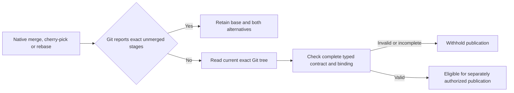

# RT-24 ordinary Git workflows and exact conflict preservation

A repository-level semantic gate must distinguish a native conflict, a Git-clean but invalid program, and a Git-clean eligible candidate. This fixture checks the distinction in normal merge, cherry-pick and rebase workflows. It uses isolated temporary repositories and reads exact committed or index objects.

## Candidate workflow

A semantic path can use a conservative binary merge policy where ordinary text merging cannot preserve typed alternatives. Preserve the base and both native conflict stages if the file cannot be combined. When Git produces a clean commit inside a disposable candidate context, reconstruct its exact complete semantic input. Validate the result before publishing it to the selected workspace or ordinary branch. A local Git exit code or a lack of index conflict entries provides a structural signal with narrower scope.



The fixture declares an explicit binary merge attribute for one semantic slot. The remaining fields are simple LF-normalized text facts. One branch tightens a shared contract bound. Another changes its provider or only a note. The joint gate compares the selected provider value with the selected bound. It tests a complete small obligation and does not use a general typed importer.

## Native matrix

The 36 cases cross three Git operations, SHA-1 and SHA-256 stores, two core line-ending settings and three edit scenarios. Under both settings the committed contract bytes follow the explicit LF attribute value.

| Edit type | Cases | Exact observation |
|---|---:|---|
| Both sides edit one binary semantic slot | 12 | Git stops with stages 1, 2 and 3 for the slot. The exact base and both alternatives remain readable |
| Disjoint contract tightening and incompatible provider | 12 | Git succeeds with no unmerged stages. The combined closed contract requires at most 5 and the provider supplies 7, so semantic admission refuses |
| Disjoint contract tightening and independent note | 12 | Git succeeds with no unmerged stages. The provider remains at 4 and the joint check admits |

The earlier [native merge-driver comparison](RT-24-NATIVE-GIT-MERGE-DRIVER-2026-11-24.md) finds pairs with the same driver inputs and different whole-graph closure. The [native mergetool comparison](RT-24-NATIVE-GIT-MERGETOOL-2026-11-24.md) preserves exact conflict stages when its coordinator is unsupported or verification fails. The [attribute study](RT-24-EFFECTIVE-MERGE-ATTRIBUTES-2026-11-25.md) observes three Git-clean invalid trees and two preserved conflict-stage cases. Together these results support a scoped merge-driver protocol that requires an independently verified exact tree and preserves both alternatives when the native merge stops. Git does not provide this semantic check automatically.

Using text merge as the only gate would admit all 12 cross-file failures in the new fixture. A conservative file policy prevents ambiguous same-file outcomes and leaves cross-file contract checks to the coordinator. Exact post-operation validation adds program-aware work while retaining ordinary Git transport and development workflows.

## Verify and limits

The [runner](GIT-WORKFLOW-GATE-01/check.py) and [ledger](GIT-WORKFLOW-GATE-01/evidence.json) use Git 2.56.1, CPython 3.12.14 and Linux 6.18.57. The study was claimed at `a3f892fc1a08bc498eb2146687457fe0c0b52d49` on `research/all`. Both Python hash seeds give identical categorical results.

```bash
fixture=research/toolchain-and-collaboration/RT-24/GIT-WORKFLOW-GATE-01
LC_ALL=C PYTHONHASHSEED=37 python3 -B "$fixture/check.py" > /tmp/llmlang-git-workflows.json
cmp "$fixture/evidence.json" /tmp/llmlang-git-workflows.json
```

The two line-ending configurations are Linux tests. Native conclusions about Windows/macOS and case- or normalization-sensitive filesystems need the corresponding environments. Hosted merge drivers, arbitrary program closure, real user resolutions and transactionally synchronized publication remain separate.
