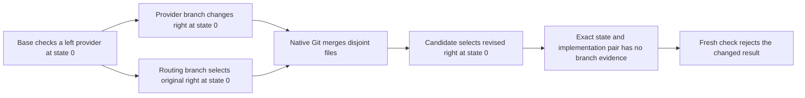

# RT-24 — Compose state-bound provider evidence across a Git merge

Each branch passes the same behavioral check before merging. The merged graph remains closed and keeps the same possible operation set. One merge nevertheless violates the contract because it selects a revised provider at a state where neither branch evaluated that exact provider. A state-bound evidence gate detects the missing case before publication.

## Method

The fixture has four admitted input states, one public contract and two operations. The contract fixes the result for each state. Each operation has one selected implementation body with a table of results. The dispatcher has one checked call occurrence per state and names the exact operation. Provider selection and implementation identities are resolved from the same imported snapshot. Source rows and the manifest are tracked in Git.

One branch changes the right operation's implementation at state 0 while the current dispatcher uses the left operation at that state. The other branch changes one guard selection without editing the providers. Both edits pass on their own branch. Native Git combines the two changes in an actual two-parent merge without a textual conflict. Each base, branch and merged tree independently reconstructs a typed closed graph. [Closed call-target merge](RT-24-CALL-TARGET-MERGE.md)



An evidence row records an observed result that agrees with the public contract for one input state, exact operation, exact implementation and contract identity. The coarse gate checks coverage using the operation, implementation and contract while dropping the input state. The state-bound gate requires a matching row for every selected source state in the whole candidate. A coverage gap remains unknown. The experiment separately runs a complete fresh check over all four states as an oracle and uses it as the fallback where coverage is missing. Rows derive from the two branch tips under the same finite model.

## Results

| Native merge | Provider-only coverage | State-bound coverage | Fresh check | Publication |
| --- | --- | --- | --- | --- |
| invalid-composition | covered | unknown | invalid | blocked |
| valid-but-uncovered | covered | unknown | valid | published |
| valid-covered | covered | covered | valid | published |

The first merge changes state 0 from the required result 10 to 99. The provider-only control reports coverage because the revised implementation has evidence for other input states. The state-bound control detects that its state 0 row is absent. The fresh check rejects publication, preserving the branch tip and missing operation receipt.

The second merge changes state 1 to the revised provider, which still returns the required result 20. Its exact state 1 evidence is absent from both branches. Fresh checking permits publication. In the third merge, switching state 2 to the unchanged left provider retains complete evidence across the two branches. The state-bound gate composes those rows and the fresh oracle agrees. Both valid cases publish the exact two-parent commit, repeat idempotently and reconstruct the same root and observations from a clean non-local clone.

## Implications for implementation choice

Operation identity, an exact provider address and a closed tree can still leave an uncovered contract input after merging. A reusable result needs the guard or input scope that was checked and the exact provider selected under that scope. Scoped reuse supports independent changes when their combined obligations are already covered. A full fresh check can resolve uncovered candidates without calling them invalid solely for missing evidence.

The fixture assumes an explicit finite dispatcher and trusted local observations as inputs. The rows are evidence from the experiment. The study leaves proof authority, general predicates and effects, source extraction, RT-20 production coordination, and independent review open.

## Reproduce

Use CPython 3.12.14 and Git 2.52.0 from the repository root.

```sh
fixture=research/toolchain-and-collaboration/RT-24/GUARDED-MERGE-EVIDENCE-01
output=$(mktemp)
python3 "$fixture/run.py" --output "$output"
cmp "$fixture/evidence.json" "$output"
python3 "$fixture/chart.py"
```

[Runner](GUARDED-MERGE-EVIDENCE-01/run.py) · [Evidence ledger](GUARDED-MERGE-EVIDENCE-01/evidence.json) · [Public interface and contract refinement](../../semantic-representation/RT-05/PUBLIC-INTERFACES-AND-CONTRACT-REFINEMENT.md)
