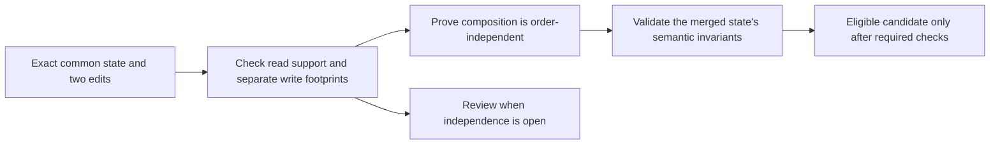

# Check independent semantic edits and post-merge validation

**Scope:** PLAN §4.3 and [#321](https://github.com/aivibeflow/LLMLang/issues/321). A single-write, total-expression model on `research/all` at `568e1e1927b4f2bb3461e95584b703f52557cd7e`.

## Question and assumptions

The [canonical semantic merge proposal](RT-24-CANONICAL-SEMANTIC-REPRESENTATION-DIFF-AND-MERGE.md) calls for proof of independence, then whole-graph validation. Two branches can write distinct fields but still compute their results from each other's writes. They can also preserve a shared invariant separately and violate it when combined. This study formalizes these distinctions without selecting the project's merge representation.

An edit specifies one written key, a set of read keys, and a total deterministic expression. Its support proof states that if two stores agree on all declared reads, the expression returns the same value. The complete footprints come from test definitions. The independence gate requires distinct write keys and that neither write belongs to the other edit's proved read set. The merge then applies both edits and validates the resulting store against the declared invariant.



A names-only rule would be simpler, but it would miss a hidden read. Further cases of commuting edits can be permitted through stronger proof rules if both semantics and conflict policy support them.

## Checked results

The [Lean model](INDEPENDENT-MERGE-01/Independence.lean) proves that one edit leaves the other's expression unchanged when its write is outside the proved read set. It proves equality of the two composition orders for arbitrary stores and edits satisfying both support and separation premises. The proof reports `propext` and `Quot.sound`. A separate theorem exhibits a two-field invariant where each independently valid edit sets one field to one and the merged result exceeds capacity one. That theorem reports the same axiom set.

The executable fixture uses 12 edits and 27 stores. It tests the 3,888 ordered pair/state combinations independently of the general Lean proof. It checks a separate capacity bound of two over three fields.

| Observation | Case count |
| --- | ---: |
| Footprint rule accepts and both orders agree | 1,458 |
| Footprint rule leaves independence open | 2,430 |
| Cases outside the footprint rule whose orders differ | 1,458 |
| Independent edits where base and both parents pass capacity | 384 |
| Of those 384, merged result fails capacity | 24 |

The omitted-read control starts at `(1,0,0)`. One edit writes zero to the first field. The other reads the first field and copies it into the second. Omitting the latter read makes the write footprints appear independent. The two application orders yield `(0,0,0)` and `(0,1,0)`. The correct support information blocks automatic composition under the tested rule.

The [ledger](INDEPENDENT-MERGE-01/evidence.json) records the exact counts, witnesses and axiom lists. The unconditional order result depends on complete support evidence for the supplied expression profile. It cannot discharge post-merge invariants. A release rule also needs actual graph/source dependency completeness, lifecycle handling for deletions and splits, exact parent selection, and proof that the merged result is the exact candidate that will be published. Those controls remain separate from this model.

## Reproduce

Use CPython 3.12.14 and Lean 4.36.0 at `611c117bfaf7b7ae1cfcf246ce6fba31e8f509e9`. Set `LEAN` to the exact executable. The [runner](INDEPENDENT-MERGE-01/run.py) regenerates the finite matrix and checks all three theorem declarations.

```sh
set -eu
fixture=research/toolchain-and-collaboration/RT-24/INDEPENDENT-MERGE-01
out=$(mktemp)
python3 -B "$fixture/run.py" --lean "$LEAN" > "$out"
cmp "$out" "$fixture/evidence.json"
```

All counts enumerate the fixed finite domain. Mermaid source was inspected directly.
