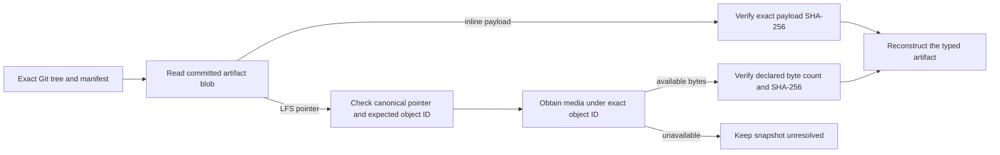

# Check exact Git LFS artifact admission

A Git tree can contain a small pointer to a large object that is stored and transferred separately. This affects whether a clone or archive can reconstruct LLMLang semantic objects and proofs. The fixture compares inline Git bytes with native Git LFS and checks both the presence and exact identity of the external payload. [Canonical Git repository contract](RT-24-CANONICAL-SEMANTIC-REPRESENTATION-DIFF-AND-MERGE.md) · [Partial and sparse Git reconstruction](RT-24-PARTIAL-SPARSE-RECONSTRUCTION-2026-11-25.md)

## Snapshot and reconstruction alternatives

A 16-byte typed artifact contains an eight-byte format marker and a signed eight-byte integer. The reference operation adds that integer to four selected inputs. The old artifact contains 11 and the current one contains 17. The small size makes identity controls easy to inspect while leaving size and performance comparisons open. The committed manifest names the artifact's canonical path, its storage profile and its payload SHA-256. The LFS storage profile uses a canonical v1 pointer giving a SHA-256 identifier and decimal size. In the inline storage control the same payload is a regular Git blob.

The runner initializes Git LFS in temporary repositories and pushes real media through its local file transfer. It compares an ordinary LFS-smudged clone, a pointer-only clone, targeted fetch for the selected commit, pull, a historic pin behind an advanced main branch, exact and stale caches, missing origin and dirty working bytes. The smudge operation is the checkout filter that replaces a pointer with media when enabled. The corrupted application-cache control is isolated from the actual Git LFS object store. Separate malformed and inconsistent metadata controls distinguish requirement binding, pointer grammar, byte count and payload digest.



The tested policies read the Git blob alone, trust working bytes, add a fallback cache keyed by path, or check the exact manifest, committed pointer and verified payload. The last policy can read media from native LFS storage or a separately supplied verified cache. The allowlisted local transfer is distinct from read-only admission, and a cache hit changes neither the working file nor Git LFS's object availability in the clone.

## Native evidence

| Reconstruction policy | Exact | Wrong acceptances | Available snapshots refused | Expected refusals |
|---|---:|---:|---:|---:|
| Read only the Git blob | 1 | 0 | 6 | 7 |
| Read working bytes | 3 | 2 | 3 | 6 |
| Read working bytes or cache by path | 4 | 6 | 2 | 2 |
| Verify manifest, pointer and object bytes | 7 | 0 | 0 | 7 |

The denominator is fourteen native settings per policy. Exact admission reconstructs all seven available snapshots. The other seven are three unavailable cases, two disagreements in size or object bytes, a manifest/object binding mismatch and a noncanonical committed pointer. The path-based cache admits six wrong snapshots. A verified separate cache reconstructs the current object while leaving the local LFS store empty, and native `git lfs fetch` retrieves the old pinned object's bytes while leaving the pointer checked out.

The committed extra-newline control returns exit 2 from native `git lfs pointer --check --strict`. The checkout filter, even with smudging disabled, emits the canonical pointer and that working file passes the strict check. Checking working bytes alone loses the committed syntax difference. The native strict pointer parser accepts the syntactically valid wrong-size case, while verifying its payload against the declared size rejects it.

The bare origin's archives with no LFS filter configured retain the exact Git artifact blobs, including pointers. With the filter configured and smudging skipped, the archive normalizes the extra-newline control to the same pointer as the checkout. An archive from the normally smudged clone includes the media when smudging is enabled. The exact Git tree and the selected archive/filter policy are separate reconstruction inputs.

## Scope and replay

The comparison covers ordinary v1 pointers without extensions, one local file transport and a small closed typed payload. HTTP service behavior, LFS media retention, concurrent and interrupted transfers, large-object performance, production cache authority, broader graph closure and independent review remain open. A deployment expecting a standalone archive needs to specify how it carries all required external media and checks the manifest against those bytes.

Replay with CPython 3.12.14, Git 2.52.0 and Git LFS 3.6.1 on Linux. The initial LLMLang baseline is `36337a7d0585ead0df086ed9b75b5413e452f153`. The ledger records exact Git commit and blob IDs, the committed manifest, archive and working-file digests, native pointer checks, cache choices and operation results.

```bash
fixture=research/toolchain-and-collaboration/RT-24/LFS-OBJECT-ADMISSION-01
PYTHONHASHSEED=1 python3 -B "$fixture/run.py" > /tmp/llmlang-lfs-admission.json
cmp "$fixture/evidence.json" /tmp/llmlang-lfs-admission.json
python3 "$fixture/chart.py"
```

[Native Git and LFS fixture](LFS-OBJECT-ADMISSION-01/run.py) · [Observation ledger](LFS-OBJECT-ADMISSION-01/evidence.json) · [Table generator](LFS-OBJECT-ADMISSION-01/chart.py)
