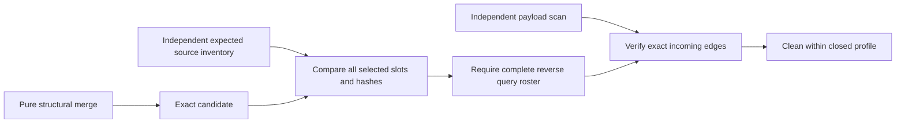

# RT-24. Merge admission with exact source and reverse coverage

A structurally closed candidate may omit a whole source declaration. Its remaining graph can have complete reverse lookups for the wrong inventory. This experiment composes the pure merge core, an independently specified exact source roster, and the existing reverse-index and payload-scan checks. The scope is one explicit declaration profile with fully named objects and exact call alternatives. [Issue #321](https://github.com/aivibeflow/LLMLang/issues/321) · [Pure merge core](RT-24-PURE-MERGE-CORE-2026-11-25.md)

The admission gate first checks the closed graph. A separate trusted fixture receipt pins the complete roster to the ordered base, ours and theirs input pins. It checks exact candidate slots and hashes against that roster. For every target selected in the baseline or candidate, admission requires exactly one reverse query. Each query binds the candidate Snapshot, declared scope, extractor and index schema. An independent payload scan checks its exact edges and digest, and admission refuses duplicate edge records.



## Results

The matrix crosses three structural cases, five source receipt states and eleven reverse input states. A structural-only gate yields 110 candidates. Whole-graph admission accepts exactly one of the 165 combinations. The other combinations include a dangling call, a complete-looking graph with an omitted caller, stale input pins, changed source rosters, a missing reverse query, stale query bindings, and omitted, invented or duplicate edges with fresh digests. [Admission matrix](MERGE-COVERAGE-01/evidence.json)

In a separate control, the projection with an omitted caller generates both its own source receipt and the complete reverse queries for its reduced graph. Trusting that receipt falsely admits the reduced candidate. Checking the separately supplied receipt refuses it. This is the trust boundary for source completeness. The existing payload scan checks the reverse index against stored declaration payloads. It cannot establish that omitted source was imported.

Lean proves that the exact comparison cannot accept a missing authoritative source row, a missing exact reverse row or a stale scope. All three statements replay without extra axioms. The proof assumes the trusted authority enumerates the required scope. General source extraction, authority authentication, dynamic graph closure, actual merge coordination and linking the Lean predicate to production code remain open. [Checked statements and axiom output](MERGE-COVERAGE-01/Coverage.lean) · [Axiom receipt](MERGE-COVERAGE-01/axioms.txt)

## Replay

Source baseline `43a84b9` on `research/all`. Replay used CPython 3.12.14 and Lean 4.36.0. Run from the repository root.

```sh
data=research/toolchain-and-collaboration/RT-24/MERGE-COVERAGE-01
scratch=$(mktemp -d)
lean "$data/Coverage.lean" > "$scratch/axioms.txt"
cmp "$data/axioms.txt" "$scratch/axioms.txt"
python -B "$data/run.py" "$scratch/evidence.json"
cmp "$data/evidence.json" "$scratch/evidence.json"
```
