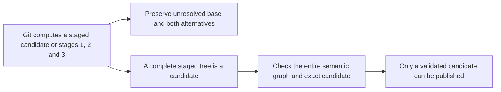

# Check native Git fallback when the semantic merge driver is unavailable

**Scope:** PLAN §4.4 and [#322](https://github.com/aivibeflow/LLMLang/issues/322). Disposable repositories on the Git 2.56.1 POSIX profile and base revision `5324a4882175d5fe652a7417403d1a106ce195c9` on `research/all`.

## Question and method

The [native driver study](RT-24-NATIVE-GIT-MERGE-DRIVER-2026-11-24.md) checks the context Git supplies to a file driver. Its unconfigured case already produced a text conflict. This study uses two edits placed far enough apart to merge cleanly as text. Can an unavailable semantic driver silently admit the combined candidate, and what does a built-in binary fallback preserve?

The base has two fields at zero and a required sum of at most one. Each branch sets one field to one and independently satisfies the invariant. The branches either edit two lines in one tracked file or edit two separate tracked files. Native merge runs with `--no-commit --no-ff`. The fixture then checks unmerged stages or evaluates the exact staged tree independently. All six cases keep HEAD unchanged.



The fixture's semantic check sums two integer fields, so it can distinguish a textually clean candidate with an invalid combined rule. It does not implement general SPG validation.

## Results

| Local policy | Edit shape | Git exit | Post-Git check |
| --- | --- | ---: | --- |
| Named custom driver without local configuration | Two disjoint edits in one file | 0 | Staged sum exceeds capacity |
| Configured command missing | Two disjoint edits in one file | 1 | Original conflict stages 1, 2 and 3 retained |
| Configured driver explicitly refuses | Two disjoint edits in one file | 1 | Original conflict stages 1, 2 and 3 retained |
| Built-in binary policy via `-merge` | Two disjoint edits in one file | 1 | Original conflict stages 1, 2 and 3 retained |
| Built-in binary policy via `-merge` | Each branch edits a different file | 0 | Staged sum exceeds capacity |
| Built-in binary policy via `-merge` | One semantic edit plus a separate ordinary-file edit | 0 | Staged sum satisfies capacity |

Git fell back to merging text when the attributes named a custom driver but local configuration did not define it. Where it kept a conflict, each unmerged blob ID matched the exact base, current or incoming version. The [machine-readable ledger](MERGE-FALLBACK-01/evidence.json) records the six results and input commits.

## Candidate fallback policy

Use a tracked conservative attribute for semantic containers if the project wants missing local setup to leave overlapping file changes unresolved. A supported adapter can be configured explicitly and can return pending when the semantic coordinator is unavailable. The built-in binary fallback protects the tested same-file changes. Git can still combine separately valid edits across files, so publication needs exact whole-graph validation after any clean Git result. A missing validator leaves the candidate pending even if all tracked paths have a stage-0 entry.

This keeps ordinary Git useful for transporting objects and inspecting conflicts. Achieving the publication guarantee for interactive use, native merge commands, hooks, cherry-pick, rebase and protected branch workflows requires a separately enforced gate. The test covers merge on this Git/OS profile and does not select a cross-platform default or normative storage representation.

## Reproduce

Use CPython 3.12.14 and Git 2.56.1. The [runner](MERGE-FALLBACK-01/run.py) creates isolated repositories and uses an explicit fixture identity and timestamp.

```sh
set -eu
fixture=research/toolchain-and-collaboration/RT-24/MERGE-FALLBACK-01
out=$(mktemp)
python3 -B "$fixture/run.py" > "$out"
cmp "$out" "$fixture/evidence.json"
```

All counts cover the six specified cases. Mermaid source was inspected directly.
