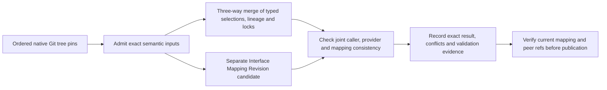

# RT-24 exact merge identities, dependency locks and mapping revisions

The repository coordinator must retain provenance for Git's exact inputs and independently compare the semantic selections, action keys and evidence subjects. A merge may combine a dependency-lock edit with a caller change, or an export mapping with a different result graph. This study specifies candidate rules for these scopes and reconciles checked lineage, conflict and native ref evidence.

## Exact delta and result records

A semantic diff starts from separately admitted exact snapshots and reports selected occurrences and typed values, required/provided contracts, per-call reference changes, dependency-lock revisions and declared lineage. A Git object identifies transport content or history. A typed snapshot identifies semantic state. Action identity binds exact runnable inputs, and evidence identity binds its claim, subject, tools, prerequisites and applicable policy. A semantic diff includes links to each relevant record. It does not derive action or proof reuse from a Git object alone.

The conflict/result envelope carries the ordered base/ours/theirs Git roots and typed snapshots, exact schema, policy and tool versions, resulting semantic selection, mapping and lock revisions, and any authorized resolution. Each conflict identifies its subject and both exact alternatives. A complete admissible candidate is clean within its model. An incompatible combined result is invalid. Unresolved nonunique choices remain conflict. Missing or stale context leaves insufficient information for admission. These dispositions remain separate from the eventual publication receipt.



## Candidate deterministic rules

- For a known managed occurrence, keep a one-sided edit when the other side retains the base. Identical edits to the same known lifetime can converge in the scoped pure rule. A divergent update, delete/update or independently added same-key lifetime requires explicit resolution. Independent added keys can compose with complete graph validation.
- Record rename and move as an occurrence transition, preserving the lifetime only under checked continuity. An explicitly recorded replacement uses a new lifetime. Split and merge name every exact old and new endpoint and require distinct affected caller obligations. Conflicting lineage leaves both alternatives.
- Merge dependency lock changes and callers' required revisions as separate exact fields. The combined candidate must satisfy every selected locked dependency and explicit migration. An isolated lock change can leave a caller outside its admitted scope.
- Track Interface Mapping Revisions outside immutable typed values. Reject ambiguous concurrent writes to the same mapping key, including equal-looking writes when intent is independent. Validate disjoint-key combinations against the full catalog and dependent export/provider proofs. Bind current mapping and peer revision in the publication CAS. Never publish a mapping based only on a successful field-level merge.

## Checked comparisons

The new fixture checks twelve directed transition cases and both parent orders. Six are clean within its profile, five conflict and one is invalid. It covers independent and ambiguous additions, same-entity and delete/update conflicts, independent move with update, split, merge, conflicting lineage, replacement, same-key mapping writes, and aligned or stale dependency locks. A separate stale revision control returns insufficient context. The model presumes exact checked typed facts. It does not authenticate real parent declarations or reconstruct an arbitrary combined graph.

Four identity controls change physical tree, semantic selection, toolchain or proof policy one at a time. The modeled tree-only change leaves typed/action/proof subjects stable. Toolchain changes invalidate the exact action and its dependent evidence. The evidence policy can change the evidence scope alone. The real audit may also bind the native Git provenance whenever the claim requires it.

The [pure merge core](RT-24-PURE-MERGE-CORE-2026-11-25.md) verifies 4,096 candidate selection pairs, and the [typed lineage comparison](RT-24-IDENTITY-LINEAGE-AND-REBIND-2026-11-25.md) checks 704 caller transition cases. The [native conflict replay](RT-24-CONFLICT-RESOLUTION-REPLAY-2026-11-24.md) captures both alternatives and distinguishes exact commit roles even at equal trees. The [native cross-map study](RT-24-CROSS-MAP-REFS-2026-11-25.md) checks 48 publication schedules. Verifying only the changed ref allows six ineligible publications. Transactional validation of the exact peer tuple publishes the six permitted proposals and rejects the rest.

Treating mappings and typed objects as one merge slot can invalidate semantics for a pure export revision. Merging them as completely independent changes can authorize an inconsistent pairing. The candidate merges records at their own scopes and checks their exact cross-constraints before publication.

## Verify and limits

The [runner](MERGE-IDENTITY-LOCKS-01/check.py) and [ledger](MERGE-IDENTITY-LOCKS-01/evidence.json) use Git 2.56.1 and CPython 3.12.14 with four input ledgers pinned at `9cbe01391f984a62c7a6309b09bbd86cf60bf4ed`. Two hash seeds reproduce the same records.

```bash
fixture=research/toolchain-and-collaboration/RT-24/MERGE-IDENTITY-LOCKS-01
PYTHONHASHSEED=37 python3 -B "$fixture/check.py" > /tmp/llmlang-merge-identity-locks.json
cmp "$fixture/evidence.json" /tmp/llmlang-merge-identity-locks.json
```

Whole-language source completeness, authentic lineage for arbitrary ancestry, package and mapping authority, and generalized transactional publication still need separate validation.
